# HiLabs Hackathon: Centene PPO price transparency pipeline (C0 to C7)

This repository reads Centene's public price transparency files and turns them into one Excel file a contracting team can use: **one row per NPI, TIN, practice address and billing code, with the specialty and the negotiated rate**, for Health Net's **California commercial group PPO network**. On the way it grades how good the files are, works out which providers really are in the PPO network, finds where each provider actually practises (NPPES alone is stale), and scores every provider's cost against similar providers.

Everything runs with one command (or one button in the browser UI), streams the 700 MB rate file instead of loading it, and writes all the hackathon deliverables into `pipeline/out/deliverables/`.

- [1. What the pipeline produces](#1-what-the-pipeline-produces)
- [2. Tech stack](#2-tech-stack)
- [3. Quick start](#3-quick-start)
- [4. UI-Guide](#4-ui-guide)
- [5. Inputs and outputs](#5-inputs-and-outputs)
- [6. The C0 to C7 flow](#6-the-c0-to-c7-flow)
- [7. Each step: flowchart, rules, fixed values and metrics](#7-each-step-flowchart-rules-fixed-values-and-metrics)
- [8. More ways to run it](#8-more-ways-to-run-it)
- [9. How long each step takes, and the bottlenecks](#9-how-long-each-step-takes-and-the-bottlenecks)
- [10. Known limits](#10-known-limits)
- [11. Repository layout](#11-repository-layout)

---

## 1. What the pipeline produces

Every number and graph in this README comes from one run of the code on `main` with the two input files kept in `pipeline/inputs/` (the HiLabs workbook and the saved Health Net PPO directory check, which covers all 3,734 NPIs in the rate file):

```bash
cd pipeline
python -m ptd_run all --fetch-public --as-of 2026-10-18
```

The Centene files were dated 2026-09-28/30. Rerunning the same command with the same inputs gives the same rows; a later month's files or a newer directory check will move the numbers.

| Measure | Result |
|---|---|
| Index files found and parsed (Step 0, C1) | 11 of 11 |
| Plan x rate-file rows / unique rate files (C1) | 3,270 / 33 |
| California commercial group plans (C2) | 1,312, all pointing to **one** Health Net rate file |
| Plan types (C2) | PPO 453, HMO 723, EOA 127, POS 6, unknown 3 |
| File quality score (C3) | **84.3 / 100, grade B** |
| Rate file shape (C4) | 701.6 MB, 2,825 provider references, 1.5M price rows, 775 codes, 134 of 583 workbook codes |
| NPI + TIN pairs: confirmed PPO / candidate / unresolved / non-PPO (C4) | **780** / 1,866 / 1,119 / 10 |
| Rates extracted, NPI x TIN x code x variant (C4) | 6,754 (2,785 NPIs, 2,207 TINs) |
| NPIs linked to an address / a **verified** address (C5) | 99.79% / **36.59%** |
| TINs linked to an address / a verified address (C5) | 99.90% / 35.77% |
| **Deliverable 1** rows, confirmed PPO (C6) | **1,508 rows**: 276 NPI + TIN pairs, 171 TINs, 107 codes |
| Candidate file 1b rows, not confirmed (C6) | 5,278 |
| Confirmed PPO providers / TINs scored for cost (C7) | 213 / 121 |
| Candidate providers scored separately (C7) | 2,370 |

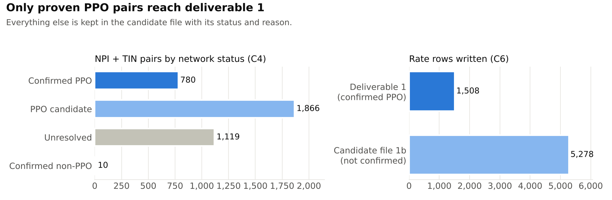

**Only proven PPO pairs reach deliverable 1.** The rate file leaves `network_name` blank on all 2,825 provider groups, so it can't tell you which provider is PPO. A pair is confirmed only when Health Net's own Find a Provider site lists that NPI as PPO under that TIN. Everything else stays in the candidate file 1b with its status and reason, so nothing is lost and nothing unproven is presented as PPO.

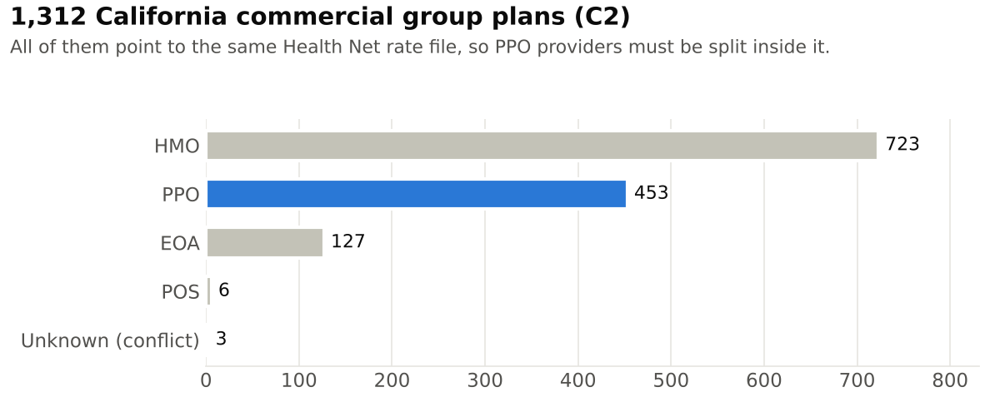

**The PPO network is one file.** All 1,312 California group plans, PPO and HMO alike, point to the same Health Net rate file. C2 can only label the plans; C4 has to split PPO providers from HMO providers inside that file.

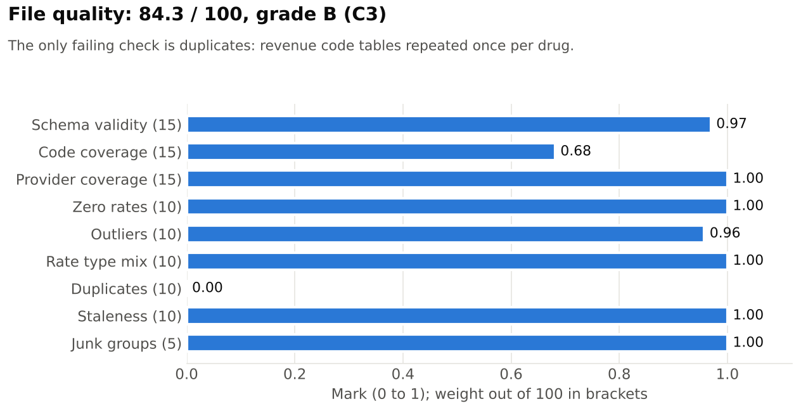

**The file is well formed but prices few of HiLabs' codes.** Only 134 of the workbook's 583 codes appear (68% of expected volume once weighted). The one failing check, duplicates, comes from Health Net repeating the same revenue-code price table once per drug name (see C3).

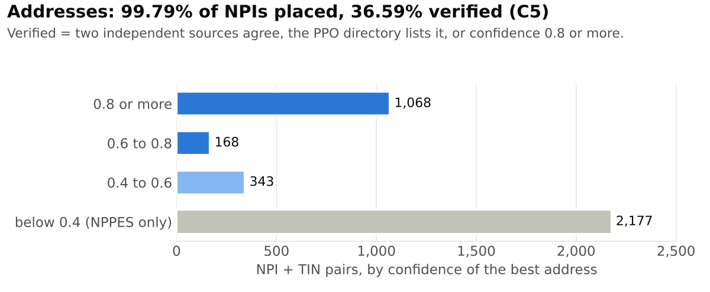

**Almost every NPI gets an address, and about a third are verified by a second source.** The rest rest on NPPES alone, which is why each row carries its confidence and sources.

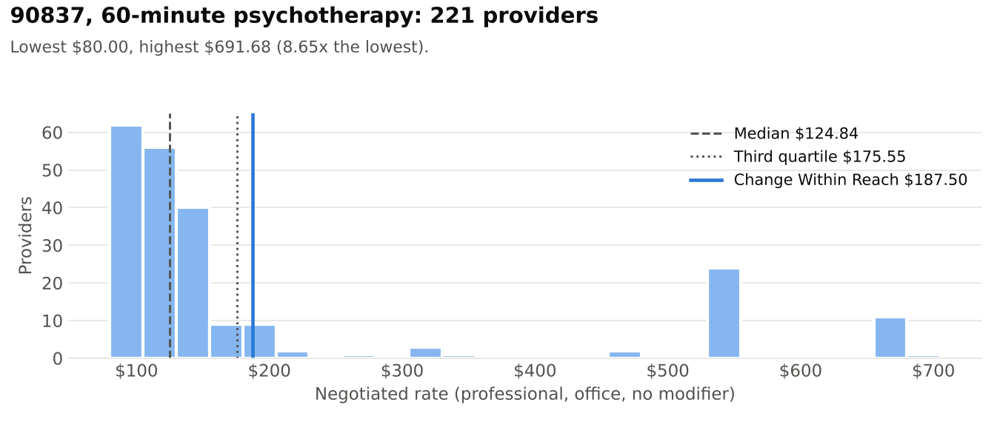

**Prices for the same service vary a lot.** For 60-minute psychotherapy the highest rate is 8.65 times the lowest, with a second cluster near $500 to $690.

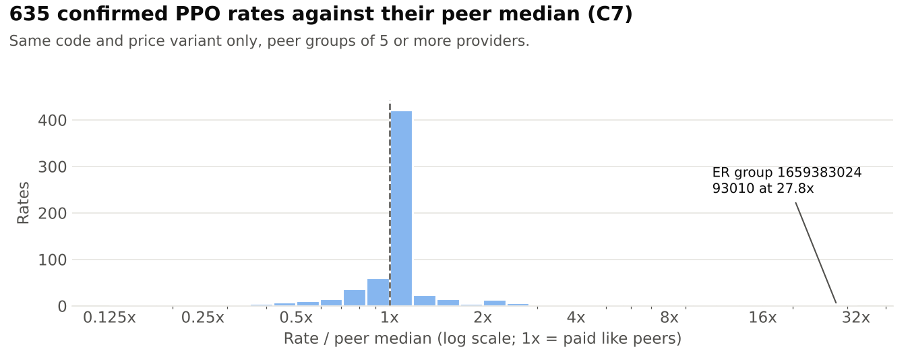

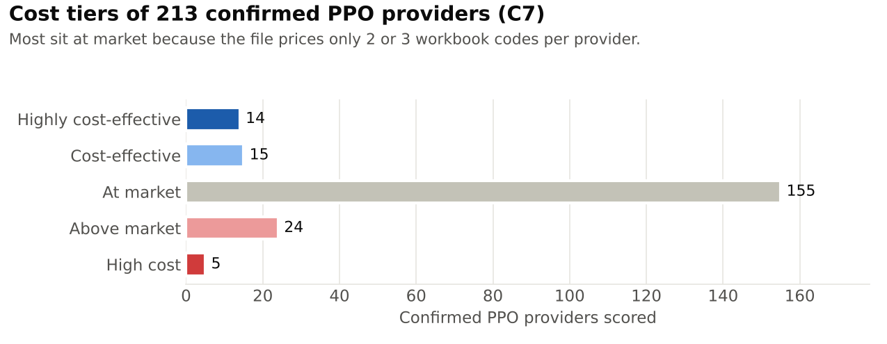

**Most confirmed providers are paid like their peers.** Each provider has only 2 or 3 priced codes, so most cost scores sit near "At market"; the outliers are the useful part.

| # | Deliverable | File in `pipeline/out/deliverables/` |
|---|---|---|
| 1 | Provider rate file (Excel): NPI, TIN, Address, Billing Code, Specialty, Rate, confirmed PPO only | `1_provider_rate_file.xlsx`, `1_provider_rate_file_with_cost_scores.xlsx` |
| 1b | Rates not confirmed PPO, kept for review | `1b_candidate_rates_not_confirmed.xlsx`, `1c_network_check_sample.csv`, `1d_network_accuracy.md` |
| 2 | Logic file: (a) PPO network, (b) TIN to NPI to address | `2_logic_file.md` |
| 3 | File quality metrics | `3_file_quality_metrics.md` |
| 4 | Summary | `4_summary.md` |
| 5 | Video | not in the repo |
| 6 | Code repo, re-runs from this README | this repository |
| 7a | Browser UI over the results | `run_ui.py`, `ptd_ui.py`, `ui/` (see [UI-Guide](#4-ui-guide)) |
| 7b | Cost-effectiveness metrics (C7) | `7b_cost_effectiveness_metrics.md`, `7b_cost_effectiveness.xlsx` |

---

## 2. Tech stack

| Layer | What we use | Why |
|---|---|---|
| Language | **Python 3.10+** | One language for the pipeline, the API and the tests |
| Streaming JSON | **ijson** | Reads the 700 MB rate file and the index files item by item, so memory stays flat |
| Parallelism | `multiprocessing` (standard library) | C4 splits the rate file's price items over several worker processes |
| Storage | **SQLite** (`sqlite3`, standard library) | One shared rate store (`out/rates.sqlite`) that C4 to C7 and the UI read; C1's plan table (`data/ptd.sqlite`) |
| Numbers | **NumPy** | Peer groups, quantiles and percentiles in C7 |
| Web scraping | **requests**, **BeautifulSoup4** | Finds the index links on the Centene page by page structure |
| Directory check | **Playwright** + Chromium | Drives Health Net's Find a Provider site (a JavaScript app) and saves its JSON answers; only needed when no saved check is in `pipeline/inputs/` |
| Configuration | **PyYAML** | Every threshold and weight lives in `pipeline/config/c2.yaml` to `c7.yaml` with its reason |
| Excel output | **openpyxl** | Writes the deliverable workbooks; reads the HiLabs workbook |
| Public data | NPPES monthly file, CMS Doctors and Clinicians, NPI Registry API, US Census geocoder | Addresses, specialties and address merging in C5 and C6 |
| UI backend | Python standard library `http.server` (`ThreadingHTTPServer`) | A small JSON API over the pipeline's real outputs, plus one endpoint that runs `ptd_run` and streams its log |
| UI frontend | Plain HTML, CSS and JavaScript, no framework and no npm | Neumorphic design system described in `design.md` |
| Tests | **pytest** | Offline tests, including a synthetic California world with known answers and UI integration tests |
| Docs | Mermaid flowcharts (rendered by GitHub), matplotlib for the graphs in `docs/images/` | |

---

## 3. Quick start

```bash
git clone https://github.com/Medix1075/HiLabs_Hackathon.git
cd HiLabs_Hackathon
python -m venv .venv
source .venv/bin/activate            # Windows PowerShell: .\.venv\Scripts\Activate.ps1
pip install -r pipeline/requirements.txt
```

**Run the whole pipeline** (about 5 minutes; downloads about 2 GB of public files the first time):

```bash
cd pipeline
python -m ptd_run all --fetch-public --as-of 2026-10-18
```

The HiLabs workbook and the saved PPO directory check are read from `pipeline/inputs/`, so no other flags are needed. `--as-of` fixes the date used for expiry and record age, so two runs give the same rows.

**Open the UI** (from the repository root):

```bash
python run_ui.py
```

Open the URL it prints (normally `http://127.0.0.1:8000`). The UI reads the real `pipeline/out/` results; before the first run it shows "Not available" and the exports stay disabled. You can also start the run from the UI's **Run pipeline** tab. Optional flags: `--port 8001`, `--no-browser`, `--pipeline-dir /path/to/pipeline`.

**Run the tests:** `cd pipeline && PTD_NPI_API=off pytest` (offline).

---

## 4. UI-Guide

The UI has nine tabs. Each one answers one question an analyst or a contracting team would ask. The examples below use the results of the run in section 1, so you can type the same NPIs and get the same answers.

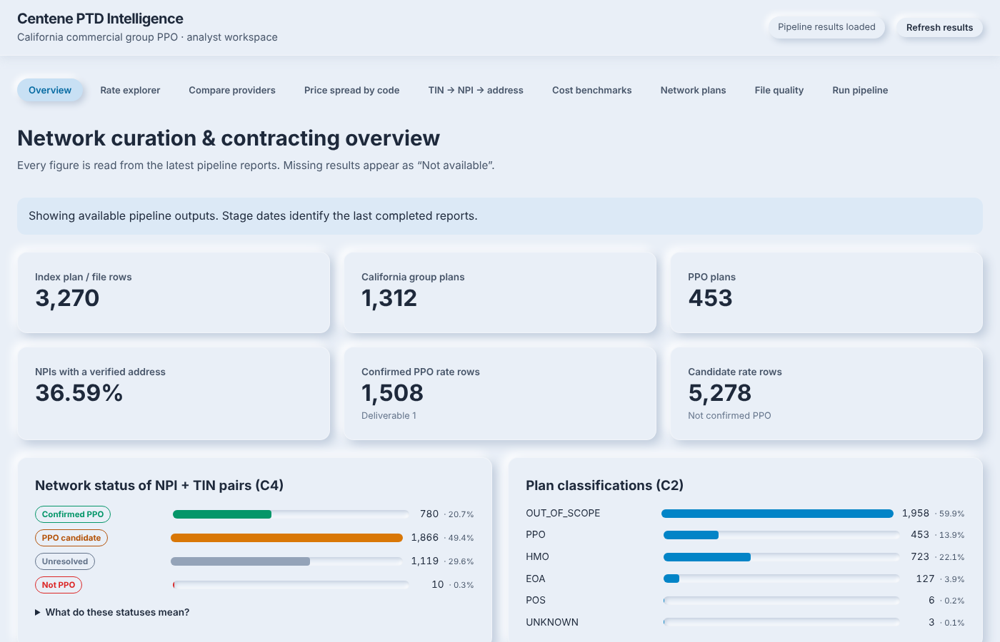

- **Overview.** *"Can I trust the PPO list?"* Only 780 NPI + TIN pairs are proven PPO, while 1,866 are candidates and 1,119 are unresolved. So deliverable 1 (1,508 rate rows) is the safe set, and the 5,278 candidate rows still need confirming before anyone relies on them.
- **Rate explorer.** *"What does Change Within Reach get paid?"* Enter NPI 1003207002 and you get $187.50 for 90837 (60-minute therapy) at 17777 Ventura Blvd, Encino. It is a PPO candidate and sits in the Above market tier, with low confidence because it bills only one code.
- **Price spread by code.** *"Is $187.50 for 90837 high?"* Across 221 providers the median is $124.84, a quarter of providers are at $80, and the highest is $691.68 (8.65× the lowest). So $187.50 is above the third quartile ($175.55), and the cluster near $500 to $690 is worth a closer look.

  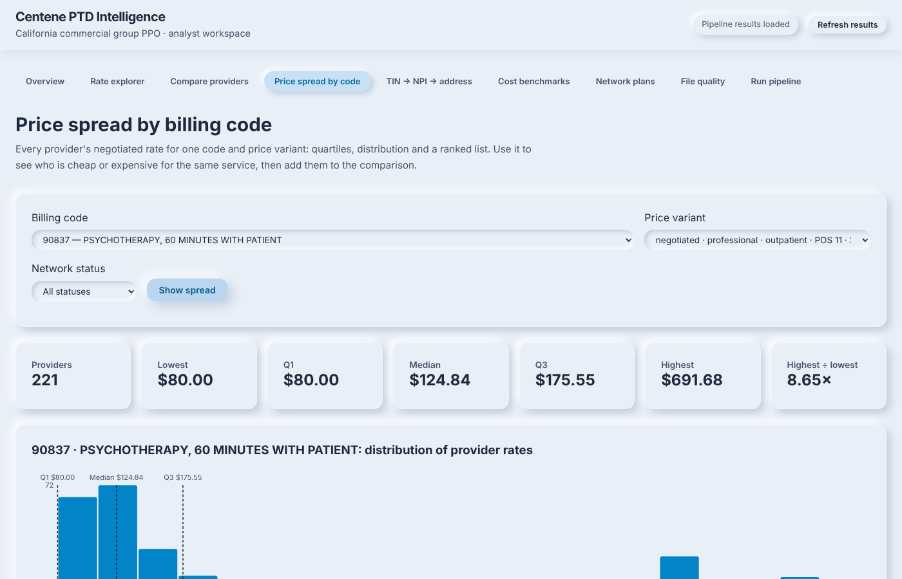

- **Compare providers.** *"Who should we steer patients to for therapy?"* Add 1003207002, 1013162296 (Nikki Thomas) and 1093460388 (Blue Chair Family Therapy). For 90837, Nikki Thomas and Blue Chair charge $80 against $187.50, about 57% less. Add an emergency group like 1659383024 and its rows show "Not billed", because it doesn't bill therapy codes.

  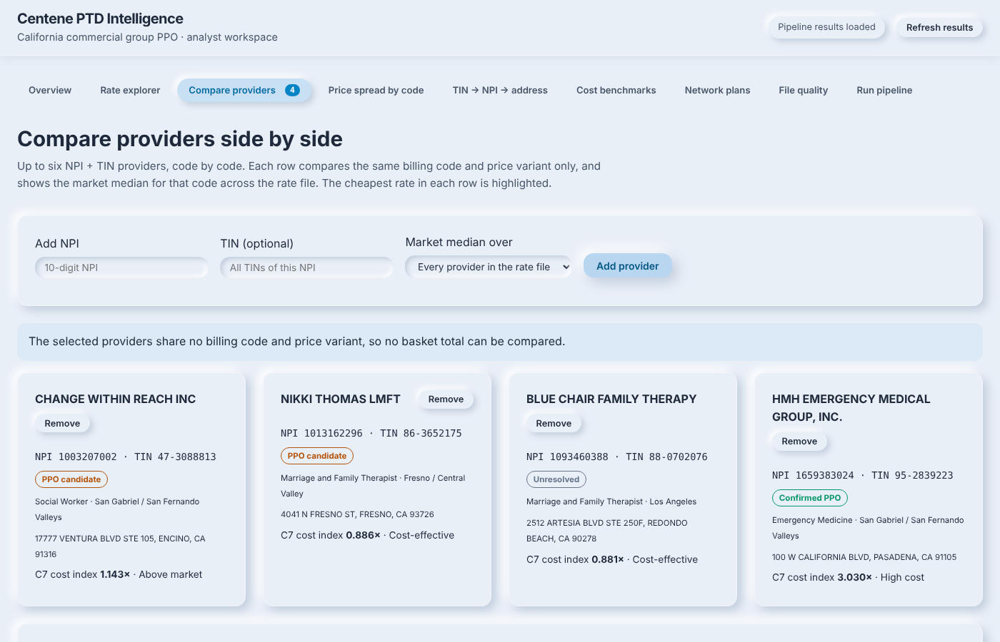

- **TIN → NPI → address.** *"Who bills under Apria Healthcare, and where?"* TIN 33-0057155 has 80 NPIs. NPI 1366479099 bills under 5 TINs, Quest and Jules Stein among them, and each pair gets its own status: it is Confirmed PPO under Quest's Unilab TIN 71-0897031 (its own directory listing), Not PPO under Quest's Nichols Institute TIN (capitated), and a candidate under the other three because only other members of those contracts are listed. Only 36.6% of NPI + TIN pairs (1,377 of 3,764) have a verified best site.
- **Cost benchmarks.** *"Why is this ER group flagged?"* NPI 1659383024 charges $506.84 for 93010 (an ECG read), against a peer median of $18.21 across 12 peers, which is 27.8×. In the other direction, All Care Physical Therapy (1104120385) charges $28.86 for 97110 against a $107.45 median of 10 peers, about 0.27×. Santa Barbara Radiology's 77407 rate has only 3 peers, below the minimum of 5, so it is shown but not used in a cost score.
- **Network plans.** *"Why is Bronze PPO 5800/60 called PPO?"* The file has no network name, so C2 labels it from the plan name, with medium confidence. The file-level vote is mixed: 453 PPO plans against 856 non-PPO across 1,312.
- **File quality.** *"Why do so many providers have no rates?"* Only 134 of the 583 workbook codes, about 23%, appear in the file, which covers 68% of expected volume. The file has 2,915 schema problems in 1.9 million records, mostly blank network names, and grades B (84.3).
- **Run pipeline.** *"Which inputs made these numbers?"* The panel shows the two files found in `pipeline/inputs/`: `Rate Benchmarking Individual Weights_Hackathon.xlsx` and `c4_ppo_check (1).csv`, which covers 3,734 NPIs. To use a newer directory check, put it in `pipeline/inputs/`: a file named exactly `c4_ppo_check.csv` is used first, otherwise the PPO check CSV covering the most NPIs. The panel shows which file and how many NPIs the next run will use; the run uses it as is and doesn't search the site again.

Other things worth knowing:

- Every tab reads the latest files in `pipeline/out/`; **Refresh results** reloads them after a run.
- The rate explorer filters by NPI, TIN, provider name, billing code, specialty, region, network status, cost tier and rate range, and sorts by rate. Tick providers there or in the price spread to add them to the comparison (up to six).
- The confirmed PPO downloads (CSV, Excel, Excel with cost scores) are C6's and C7's actual deliverables. Candidate rates have their own, clearly labelled download.
- Confirmed and candidate providers are benchmarked separately, so unproven rates never move the PPO peer medians.
- **Run pipeline** lets you pick the start and end stage, the as-of date, the C4 workers and optional local files. Paths are on the machine running the server, absolute or relative to `pipeline/`. Only one run can execute at a time; its log streams into the page and is saved in `pipeline/out/ui_runs/`. Closing the UI server stops its run; closing only the browser tab doesn't.

---

## 5. Inputs and outputs

### Inputs

| Input | Where it comes from | Used in | Needed? |
|---|---|---|---|
| Centene price transparency page and its 11 index files | https://www.centene.com/price-transparency-files.html (found by the scraper, never typed in) | Step 0, C1 | Yes |
| Health Net CA in-network rate file (701.6 MB) and allowed-amount file | URLs inside the Health Net index | C2 to C4 | Yes |
| HiLabs workbook *Rate Benchmarking Individual Weights_Hackathon.xlsx* (taxonomy crosswalk, specialty weights, 946 specialty x code weights over 583 codes) | Given by HiLabs; kept in `pipeline/inputs/` | C3, C4, C6, C7 | Strongly recommended |
| Saved Health Net PPO directory check (`c4_ppo_check*.csv`): Find a Provider result per NPI + TIN | Kept in `pipeline/inputs/`; made by C4's live search (findaprovider.healthnetcalifornia.com) | C4, C5 | Needed to confirm any PPO provider |
| NPPES monthly file (1.16 GB zip, includes the Practice Location file) | CMS, downloaded by `--fetch-public` | C5, C6 | Recommended |
| CMS Doctors and Clinicians file (900 MB) | CMS, downloaded by `--fetch-public` | C5 | Recommended |
| NPI Registry API | npiregistry.cms.hhs.gov, live, cached 30 days | C5 (NPIs missing from NPPES), site check (city per NPI) | Automatic |
| US Census Bureau geocoder | geocoding.geo.census.gov, free, no key, cached 1 year | C5 | Automatic |
| NUCC taxonomy CSV | nucc.org (`--nucc`); the automatic download currently finds no link | C6 (readable names for unmapped taxonomies) | Optional |
| ZIP to county file | e.g. HUD ZIP-COUNTY (`--zip-county`) | C5, C7 regions | Optional (else ZIP3 areas) |

**Inputs kept in the repo.** `pipeline/inputs/` holds the workbook and the saved directory check, and every run picks them up without flags (`pipeline/ptd_run/inputs.py`). A path on the command line (`--workbook`, `--ppo-check-csv`) always wins.

| File | If it is missing |
|---|---|
| HiLabs workbook (the exact name first, else any other `.xlsx` there) | Every billing code is extracted and C7 weights codes equally |
| PPO directory check (`c4_ppo_check.csv` first, else the `*ppo_check*.csv` covering the most NPIs) | C4 searches the Health Net site live (Playwright; resumable; about 12 hours for the whole file). `--no-check-directory` or `PTD_DIRECTORY_CHECK=off` turn that off |

### Outputs

| Folder | What is in it |
|---|---|
| `pipeline/data/` | Downloaded index files (`raw/`), the C1 table (`index_table.csv`, `rate_files.csv`, `ptd.sqlite`), rate files (`rate_files/`), public files (`public/`), API and geocoder caches |
| `pipeline/out/c2/` | Plan classification, PPO rate-file list, exclusions, conflicts, validation sample |
| `pipeline/out/c3/` | Score per file, every metric with its justification, schema problems, example bad rows |
| `pipeline/out/c4/` | Network status per reference and per NPI + TIN, `c4_ppo_check.csv`, extraction log |
| `pipeline/out/rates.sqlite` | The shared rate store C4 to C7 and the UI read |
| `pipeline/out/c5/` | Addresses with confidence, every candidate address, the address logic |
| `pipeline/out/c6/` | Deliverable 1, candidate file, hand-check sample, accuracy report |
| `pipeline/out/c7/`, `out/c7_candidates/` | Cost scores per rate, provider and TIN; peer benchmarks; metrics file |
| `pipeline/out/deliverables/` | Copies of deliverables 1 to 4 and 7b with the names in section 1 |
| `pipeline/out/ui_runs/` | Logs of runs started from the UI |

`pipeline/data/` and `pipeline/out/` are not committed: they are rebuilt on every run so they always match the current month's files.

---

## 6. The C0 to C7 flow

The challenge statement splits the work into three core problems (network mapping, grading files, address mapping) and supporting steps. Each step reads the previous step's output.

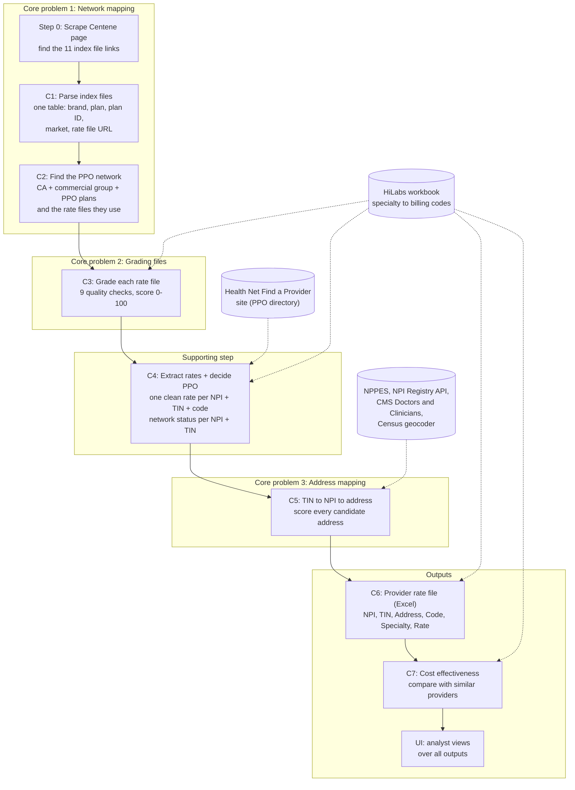

| Step | Package | One-line job |
|---|---|---|
| Step 0 + C1 | `ptd_pipeline/` | Find the 11 index files and flatten them into one plan table |
| C2 | `ptd_c2/` | Keep California commercial group plans, label each PPO / HMO / EPO / POS / EOA, list the PPO rate files |
| C3 | `ptd_c3/` | Grade each rate file with 9 quality checks |
| C4 | `ptd_c4/` | Pull one clean rate per NPI + TIN + code + variant, and decide each NPI + TIN's network status |
| Directory | `ptd_dir/`, `ptd_c4/dircheck.py` | Search every NPI on Health Net's Find a Provider site |
| C5 | `ptd_c5/` | Find and score each NPI + TIN's practice address |
| C6 | `ptd_c6/` | Write the provider rate file (deliverable 1) and the candidate file |
| C7 | `ptd_c7/` | Score cost against similar providers |
| Runner | `ptd_run/` | Run everything, find the repo inputs, write the summary, logic file and metrics file |
| UI | `run_ui.py`, `ptd_ui.py`, `ui/` | Serve the analyst views and start runs |

---

## 7. Each step: flowchart, rules, fixed values and metrics

Every number a judge might want to change lives in `pipeline/config/c2.yaml` to `c7.yaml`, with a comment saying why. The tables below list them ("fixed values") next to the step that uses them. A few defaults are command-line options instead; those are marked "CLI".

### Step 0 and C1: read the index files

**What it does.** Reads the Centene page, finds the index links under "Links to the download TOC files" (skipping the "Centene Employees" section), downloads each index and writes one row per plan x rate file.

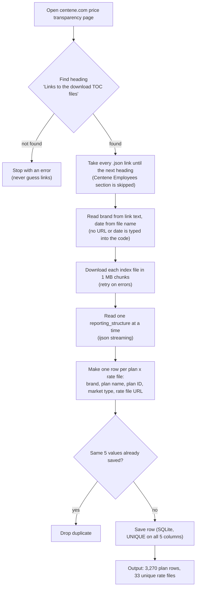

| Fixed value | Value | Why |
|---|---|---|
| Section heading looked for | "Links to the download TOC files" | Links are taken by page structure, so the employee "HEALTH NET" link is never picked up |
| Download chunk | 1 MiB, through a `.part` file | Flat memory, no half-written files |
| Dedup key | all 5 columns (`UNIQUE` in SQLite) | `plan_id` is reused and has placeholders like 999999999, so it can't be a key on its own |

**Metrics here:** index files found vs parsed, rows read vs unique rows. **Result:** 11 files, 3,270 unique rows, 33 rate files (checked against an independent `json.load` of every index).

### C2: find the PPO plans and files

**What it does.** Keeps plans that are commercial group, Health Net and California, labels each one PPO / HMO / EPO / POS / HSP / EOA using several kinds of evidence in a fixed priority order, and lists the rate files the PPO plans use.

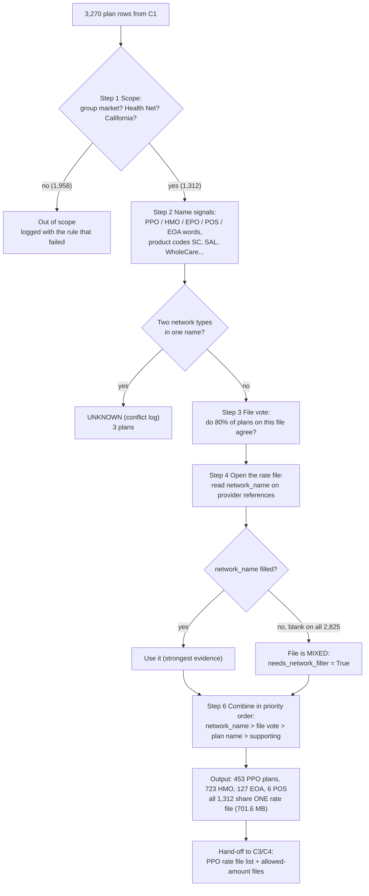

| Fixed value (`config/c2.yaml`) | Value | Why |
|---|---|---|
| `scope.keep_market_types` / `keep_brands` / `target_state` | group / healthnet / CA | The brief's scope |
| PPO keywords | `PPO`, `CUSPPO` | Real names include "CA L CUSPPO 15/250/20% RAP" |
| Non-PPO types | HMO, EPO, POS, HSP, EOA | EOA (Elect Open Access) is an HMO-based product; POS is not PPO |
| HMO product codes | SC, SmartCare, SAL, Salud, WholeCare, CommunityCare, Full Network; HSP: PureCare | Health Net product names |
| `EC` (EnhancedCare) | PPO only when no other type is in the name; `include_enhancedcare_ppo: true` | All 140 EC plans sit next to HMO or EOA in the real index |
| `file_vote.label_threshold` | 0.80 | A file is called PPO or non-PPO only when 80% of its other plans agree |
| `hypothesis_gate` | precision 0.90 on at least 10 plans | Weak name hints are tested before they are used |
| `supporting.payment` | ffs share 0.90, capitation share 0.20, at least 20 items | Payment pattern can only adjust confidence, never the label |
| `network_probe.max_bytes` | 200 MB | Enough to read the provider references at the top of a file |
| `validation.sample_size`, `seed` | 25, 42 | Hand-check sample against Summary of Benefits |

**Metrics here:** plans per label, conflicts, decided_by, confidence (high / medium / low). **Result:** 1,312 in scope, 453 PPO, 723 HMO, 127 EOA, 6 POS, 3 conflicts left UNKNOWN; the file vote is mixed (453 PPO / 856 non-PPO), so every in-scope plan is labelled from its name with medium confidence. **Key finding:** all 1,312 plans share one rate file with blank `network_name`, so C2 marks it `needs_network_filter = True` and C4 has to split PPO providers from HMO providers inside it.

### C3: grade the rate files

**What it does.** Streams each PPO rate file once and runs 9 checks. Each check gives a mark from 0 to 1; the marks are combined into a score out of 100 and a grade.

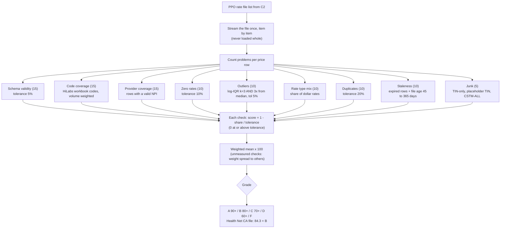

**How a check becomes a mark (the "tolerance").** For a "share of bad rows" check, `mark = 1 - share / tolerance`, and anything at or above the tolerance scores 0. Example: with a 10% tolerance for $0 rates, a file with 3% $0 rates scores 0.7.

| Metric (weight) | Tolerance | How it is calculated | Health Net CA file |
|---|---|---|---|
| `schema_validity` (15) | 5% | Problems per record against CMS schema v2.0.0 (required fields, allowed values, code formats, blank `network_name`) | 2,915 problems in 1,907,132 records (0.15%), mark 0.97; 2,825 are blank network names |
| `code_coverage` (15) | none | Share of the workbook's 583 codes present, weighted by specialty weight x code share | 134 codes present (23%), weighted 68.1%, mark 0.68 |
| `provider_coverage` (15) | none | Share of price rows tied to a valid NPI (10 digits + Luhn check digit) | 100%, mark 1.00 |
| `zero_rates` (10) | 10% | Rows with rate 0 or less | 0%, mark 1.00 |
| `outliers` (10) | 5% | Outside a log-IQR fence (k = 3) **and** at least 3x from the median of the same code + type + class + setting + modifier | 0.21%, mark 0.96 |
| `rate_type_mix` (10) | none | Share of dollar rates (negotiated, fee schedule, derived) | 100%, mark 1.00 |
| `duplicates` (10) | 20% | Rows repeating an earlier row exactly (code, providers, type, rate, class, setting, service codes, modifiers, expiry) | **97.35%, mark 0.00** (see note) |
| `staleness` (10) | 20% expired; file age 45 to 365 days | Expired rows (9999-12-31 is evergreen) and age of `last_updated_on` | 0% expired, 12 days old, mark 1.00 |
| `junk` (5) | 20% groups, 5% catch-all | TIN-only groups, placeholder TINs, bad NPIs, CSTM-ALL codes | 0%, mark 1.00 |

| Fixed value (`config/c3.yaml`) | Value |
|---|---|
| Weights | 15, 15, 15, 10, 10, 10, 10, 10, 5 (sum 100) |
| Grades | A 90+, B 80+, C 70+, D 60+, else F |
| Outlier fence | `iqr_k: 3.0`, `min_ratio_to_median: 3.0`, groups of 5+ rates |
| Placeholder TINs | 000000000, 999999999, 111111111, 123456789 |
| Duplicate check | file-wide up to 5,000,000 rows, then per item |

**Note on duplicates.** Almost all of the 1.5M price rows are revenue-code (RC) rows whose code, providers and price repeat in another item. Health Net publishes revenue code 636 (drugs) once per drug name, 129 times, each with the same 721-entry price table. Whether that counts as "duplicate" depends on whether the drug description is part of a row's identity. Our key leaves the description out, so the check scores 0 and costs the file 10 points. This is a finding about the file, not a bug, and the deliverable says so.

### C4: extract clean rates

**What it does.** Reads the provider groups (TIN + NPIs) and the prices, keeps the workbook's codes, cleans the price rows and picks one rate per NPI + TIN + code + price variant. The provider references are read by one process while the price items are split over several worker processes.

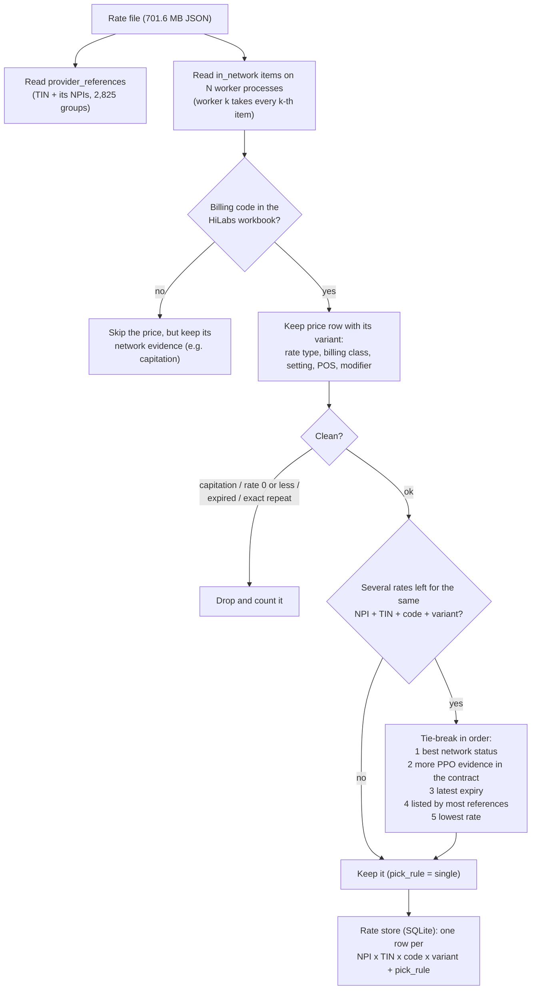

| Fixed value | Value | Why |
|---|---|---|
| `codes.scope` | `workbook` (583 codes); `--codes all` keeps every code | The deliverable and C7 weights are about HiLabs' codes |
| `extract.exclude_arrangements` | capitation | A per-member payment is not a per-service price |
| `drop_zero`, `drop_expired`, evergreen date | true, true, 9999-12-31 | $0 and expired rows are not prices |
| `tie_break` | network, ppo_evidence, expiry, support, lowest | Most trustworthy contract first, lowest rate only as a last resort |
| `stream.workers` | CPU cores minus 1 | Parallel parsing; result is the same with 1 or N workers (tested) |
| `stream.batch_rows` | 50,000 | SQLite insert batch |

**Metrics here:** price rows dropped by reason, how often each tie-break rule decided (`pick_rule`). **Result:** 141 of 1,717 items are in code scope, giving 2,720 price rows and 6,754 NPI x TIN x code x variant rates.

### C4: decide which providers are PPO

**Why this is needed.** The file has no network names, so C2's "PPO" only tells C4 which file to read, not which providers in it are PPO. The same doctor can hold a PPO contract and an HMO contract at different prices, under two provider references. So the decision is made **per NPI + TIN pair**, using evidence about that pair.

**Where the evidence comes from: Health Net's own Find a Provider site.**

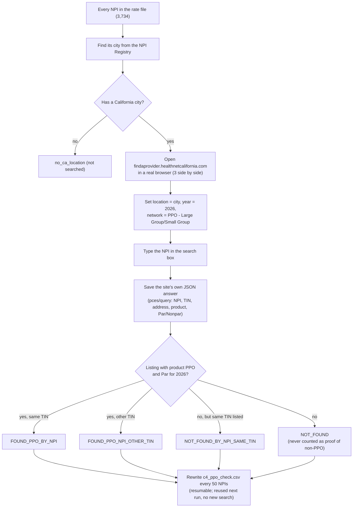

**How each NPI + TIN gets its status.**

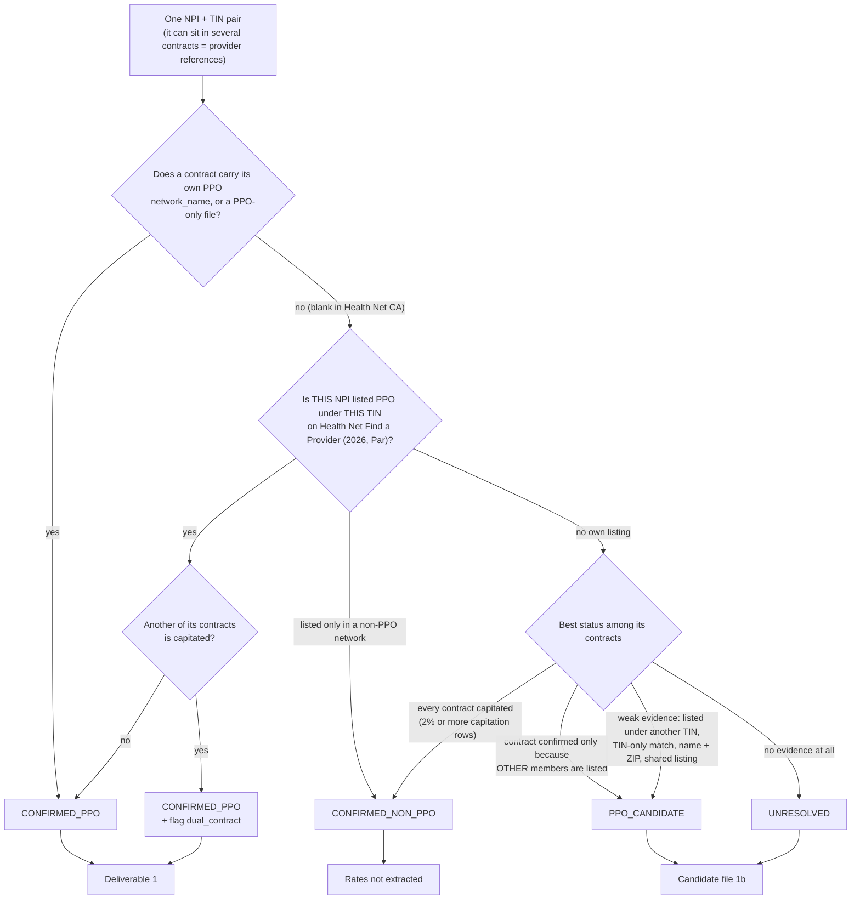

Rules in one breath: a pair is **confirmed PPO** only by its own contract's network name / a PPO-only file, or by **its own NPI being listed PPO under its own TIN**. Anything inferred from other people (other members of the same contract, the same TIN, a name + ZIP match, a listing under another TIN) can make it a **candidate**, never confirmed. Capitation (an HMO way of paying) makes a contract **non-PPO**, but a pair's own PPO listing wins over it and the pair is flagged `dual_contract`.

| Fixed value | Value | Why |
|---|---|---|
| Site network (CLI `--check-network`) | "PPO - Large Group/Small Group (Platinum, Gold, Silver, Bronze, GF Plans, HSA Compatible, HDHP)", product "HealthNet Commercial PPO", carrier "CA PPO Large and Small" | The employer group PPO network on the site |
| Year (CLI `--check-year`) | this year (2026) | Listing must be `Par` in that year |
| Browsers / save interval / delay (CLI) | 3 / every 50 NPIs / 1 s between searches | Speed vs politeness; resumable |
| Search radius | the site's 50 miles around the NPI's city | Site behaviour, not ours |
| `network.capitation_min_share` | 0.02 | 2% capitated rows marks an HMO-style contract |
| `network.seed_weights` | network_name 1.0, file_label 0.9, directory 0.9, capitation 0.8 | Evidence strength (scores, not probabilities) |
| `directory_weak_factor` | 0.4 | TIN-only or other-TIN matches count 40% and never confirm |
| `decide_min_share` | 0.65 | Share of evidence a side needs to win at contract level |
| `dual_contract` hypothesis | ratio 1.05, 3+ codes, 50% NPI overlap, used only at precision 0.90 on 10+ known pairs | "Higher-paid contract is PPO"; never passed its test on real data, so unused |
| `propagation` hypothesis | 30 iterations, alpha 0.8, 5-fold check, 90% accuracy, 5+ seeds per side, seed 7 | Label spreading over co-priced contracts; unused on real data (19 non-PPO seeds, no co-priced edges) |

**Metrics here:** status per pair and per contract, the reason (`status_basis`), site verdict per NPI + TIN. **Result:** site verdicts over 3,775 NPI + TIN rows: 781 found by own NPI, 457 found under another TIN, 351 TIN listed but not the NPI, 2,186 not found. Pairs: 780 confirmed, 1,866 candidate, 1,119 unresolved, 10 non-PPO; 669 pairs stay candidates because only other members of their contract are listed; 14 dual contracts.

### C5: link TIN to NPI to address

**What it does.** The rate file is the only public source that says which NPIs bill under which TIN (NPPES hides tax IDs). C5 collects every candidate address for each NPI, cleans them, and scores each one for that NPI + TIN.

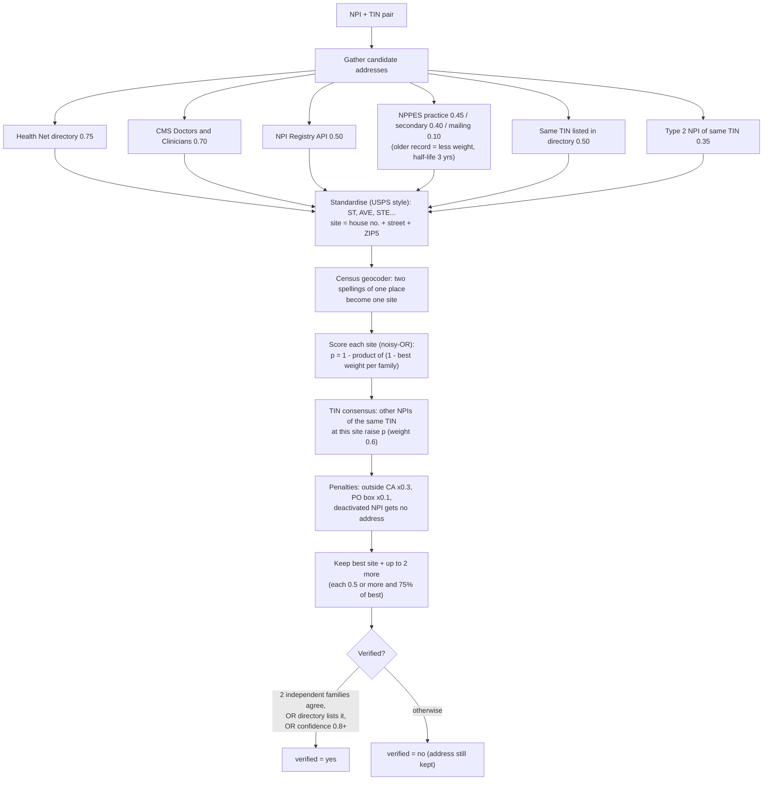

| Fixed value (`config/c5.yaml`) | Value | Why |
|---|---|---|
| Source weights | directory 0.75, CMS D&C 0.70, NPI API 0.50, same-TIN directory 0.50, NPPES practice 0.45, NPPES secondary 0.40, Type 2 site of same TIN 0.35, mailing 0.10 | How likely each source alone is a current practice site |
| Source families | NPPES variants are one family; only the best of a family counts | They share the same data, so they are not independent witnesses |
| NPPES recency | half-life 3 years, floor 0.4 | Old self-reported records are worth less |
| TIN consensus | weight 0.6, roster of 3+, new-site share 0.5, absent penalty 0.5 | A site most of a TIN shares is a real TIN site |
| Group alignment (CMS `org_pac_id`) | share 0.5, boost 0.5, discount 0.5 | Turns CMS groups into TIN-specific evidence |
| Penalties | outside CA x0.3, PO box x0.1, deactivated NPI = no address | |
| Selection | up to 3 sites; extra site needs 0.5 and 75% of best | Doctors often work at several sites of one group |
| Verified | 2 independent families, or directory listing, or confidence 0.8+ | |
| NPI API | 8 requests/s, 4 threads, 20 failures stop, cache 30 days | Polite use of a free API |
| Geocoder | batches of 1,000, CA only, cache 365 days | Merges two spellings of one place |
| Regions | ZIP3 to California market areas (e.g. 900-908 Los Angeles) | Used by C7 when no ZIP-county file is given |

**Metrics here:** % NPIs and TINs with an address and with a verified address, confidence bands, which sources agree, how often the chosen address differs from NPPES. **Result:** 99.79% of NPIs addressed and 36.59% verified (1,377 of 3,764 pairs); 1,068 pairs at confidence 0.8+, 2,177 below 0.4 (NPPES only); the best address differs from NPPES's own practice address for 369 pairs; 4,655 of 4,975 sites geocoded and 85 merged into another spelling; 187 pairs kept at more than one site.

### C6: build the provider rate file

**What it does.** Joins rates and addresses into one row per NPI + TIN + address + code, picks one headline price variant, adds the specialty and splits rows by network status.

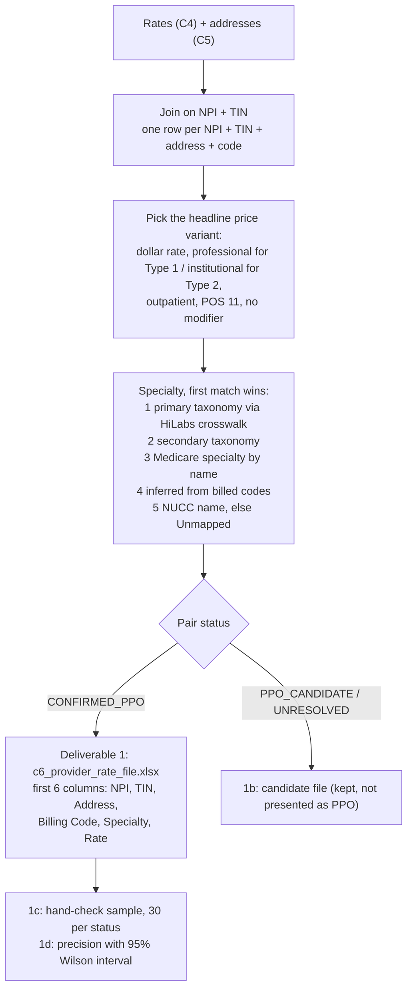

| Fixed value (`config/c6.yaml`) | Value |
|---|---|
| Headline variant order | negotiated > fee schedule > derived > per diem > percentage; professional first for Type 1, institutional first for Type 2; outpatient > both > inpatient; POS 11; no modifier |
| Specialty inference | at least 3 workbook codes, F-score 0.25 |
| Deliverable 1 / candidate statuses | CONFIRMED_PPO / PPO_CANDIDATE + UNRESOLVED |
| Hand-check sample | 30 pairs per status |
| Excel limits | 1,000,000 rows per sheet, 3,000,000 rows max (the CSV always has every row) |

**Metrics here:** rows per file, specialty source per NPI, precision of each status from the hand-check sample (Wilson 95% interval; filled in once someone checks the sample). **Result:** deliverable 1 has 1,508 rows (276 pairs, 171 TINs, 107 codes), and 1,505 of them carry a verified address. Only 276 of the 780 confirmed pairs bill a workbook code at all, which is why the file is small. Specialty source per NPI: primary taxonomy 1,988, secondary 99, unmapped taxonomy 680, inferred from codes 4.

### C7: cost effectiveness

**What it does.** Compares each rate with what similar providers get for the same code and variant, then combines a provider's codes into one cost index, score and tier. Confirmed PPO and candidate providers are scored separately, so unproven rates never move the PPO benchmark.

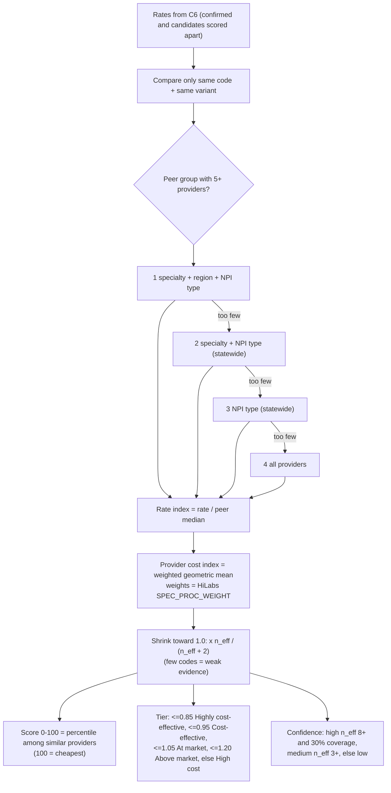

| Metric | Formula | Why |
|---|---|---|
| Rate index | rate / peer median | 1.00 = paid like similar providers |
| Cost index | weighted geometric mean of rate indexes, weights = HiLabs `SPEC_PROC_WEIGHT` | Ratios average on a log scale; common codes count more |
| n_eff | (sum w)^2 / sum w^2 | Effective number of codes behind the index |
| Shrunk index | exp(ln(index) x n_eff / (n_eff + 2)) | One cheap code is weak evidence |
| Cost score 0-100 | 100 x (1 - percentile among similar providers) | 100 = cheapest |
| TIN index | n_eff-weighted mean of members' log indexes | Group-level view for contracting |

| Fixed value (`config/c7.yaml`) | Value |
|---|---|
| Minimum peers | 5 (a rate with fewer peers is shown but not scored) |
| Peer levels | specialty + region + type, specialty + type, type, all |
| Shrinkage k | 2.0 |
| Cohort for the score | specialty + region, then specialty, then all; 10+ providers |
| Tiers | 0.85 / 0.95 / 1.05 / 1.20 |
| Confidence | high: n_eff 8+ and 30% coverage; medium: n_eff 3+ |
| Left out | percentage-of-charges rates |

**Result:** 635 confirmed rates benchmarked (329 had fewer than 5 peers), 213 providers and 121 TINs scored; tiers: Highly cost-effective 14, Cost-effective 15, At market 155, Above market 24, High cost 5. Score confidence is low for 183 providers because each has few priced codes. 2,370 candidate providers are scored in their own cohort (`out/c7_candidates/`).

---

## 8. More ways to run it

### The whole pipeline from scratch, including the site search (about 12 hours)

Without a saved check in `pipeline/inputs/`, the runner turns the live search on by itself (`--check-directory` does the same explicitly). It needs Playwright's Chromium:

```bash
python -m playwright install chromium
python -m ptd_run all --fetch-public --check-year 2026 --as-of 2026-10-18
```

The search runs 3 browsers, rewrites `out/c4/c4_ppo_check.csv` every 50 NPIs and can be stopped and restarted: it skips NPIs already searched. Run it on a machine that stays awake (a cloud container that pauses kills the browsers). Copy the finished `out/c4/c4_ppo_check.csv` into `pipeline/inputs/` to reuse it on later runs.

### A subset of NPIs

```bash
python -m ptd_run all --fetch-public --npis inputs/my_npis.csv --as-of 2026-10-18
```

`--npis` limits C4 to C7 to a list of NPIs (a list, a text file or a CSV with an `npi` column). Useful to test on 40 NPIs before the whole file.

### Parts of the pipeline

```bash
python -m ptd_run all --from c4 --to c7 ...      # rerun later steps on earlier outputs
python -m ptd_run all --from c5 --nppes data/public/<NPPES zip> --dac data/public/<DAC csv>   # skip re-downloading
python -m ptd_pipeline                           # Step 0 + C1 only
python -m ptd_c2 run                             # C2
python -m ptd_c3 run --expected-codes "<workbook>"   # C3
python -m ptd_c4 run --workbook "<workbook>" --ppo-check-csv "<saved check>"
python -m ptd_c5 run --nppes ... --dac ...
python -m ptd_c5 extract-nppes --nppes data/public/<NPPES zip> --state CA   # California-only NPPES, once
python -m ptd_c6 run --workbook "<workbook>"
python -m ptd_c7 run --workbook "<workbook>"                       # confirmed set
python -m ptd_c7 run --workbook "<workbook>" --set candidates --out out/c7_candidates
python -m ptd_run summary                        # summary, logic file, metrics file, deliverables
python -m ptd_c6 check-network --sample out/c6/c6_network_check_sample.csv   # after filling it in by hand
```

Offline switches: `PTD_NPI_API=off`, `PTD_GEOCODE=off`, `PTD_DIRECTORY_CHECK=off`. Tests: `PTD_NPI_API=off pytest` (all offline, including UI integration tests against the real C3 to C7 runner).

Known quirk: C1 writes into `pipeline/data/` even when `--data` points elsewhere, so run from inside `pipeline/` with the default folders.

---

## 9. How long each step takes, and the bottlenecks

Measured on the run in section 1 (cloud container, 4 CPU cores), from each stage's start and finish times in its `*_run_summary.json` and log. Total: **about 5 minutes**, with the Health Net site search reused from the saved CSV.

| Step | Time | What dominates |
|---|---|---|
| Download NPPES (1.16 GB) + CMS D&C (0.9 GB) | about 1 min | Network; skip it on reruns by passing `--nppes` / `--dac` |
| Step 0 + C1 | 2 s | 11 small index files |
| C2 | 4 s | Reading the top of the rate file for network names |
| C3 | 34 s | Downloading and streaming 701.6 MB / 1.5M price rows once |
| C4 | 18 s | Reading the file with 3 workers + 1 reference reader (15 s) |
| C5 | 182 s | Scanning all 9.85M NPPES rows (151 s); Census geocoder for about 5,000 sites; the rest a few seconds |
| C6 | 2 s | Writing the Excel |
| C7 | 4 s | Both sets |

**Time to map NPIs to PPO status and an address with confidence.**

| Part | Time per NPI | 3,734 NPIs (whole file) | How we know |
|---|---|---|---|
| Health Net site search (3 browsers) | about 12 s (about 36 s per browser) | **about 12 hours** | Measured: the saved check grew by about 5 NPIs a minute |
| C4 network status from the saved check | under 0.001 s | under 1 s | Measured |
| C5 address with confidence | about 0.05 s | about 3 minutes | Measured 182 s for 3,725 NPIs; most of it is a fixed NPPES scan, so it barely grows with more NPIs |
| NPI Registry API (only when no NPPES file is given) | 0.125 s (8 per second) | about 8 minutes | From the configured rate limit. Estimate |

**Bottlenecks, biggest first.**

1. **The site search is 99% of the end-to-end time** (about 12 hours vs 5 minutes). It drives a real browser per NPI because the site is a JavaScript app with no bulk download. That's why the finished search is kept in `pipeline/inputs/` and reused. Ways to cut it further: call the site's own search API directly instead of clicking through pages, run more browsers, or search once per TIN instead of once per NPI.
2. **NPPES scan (151 s).** C5 reads all 9.85M national rows to find about 3,700 NPIs. `python -m ptd_c5 extract-nppes --state CA` makes a California-only file once; scanning that takes seconds.
3. **Geocoder.** One request per 1,000 sites; answers are cached for a year, so a rerun is nearly free.
4. **C3 reads the rate file a second time (34 s).** C3 and C4 each stream the 701.6 MB file. A combined pass would save about 15 s; not worth the extra coupling at this size.
5. **Downloads (about 1 min).** Only on the first run.

For scale: on a 385 MB synthetic file with 40,000 references and 15.9M output rates, C4 took 73 s and 434 MB of memory. The design streams item by item, shards work across processes, and stores repeated provider lists once ("refsets"), so memory stays flat as files grow.

---

## 10. Known limits

- **Deliverable 1 depends on the site listing each NPI under its own TIN.** Organisations are listed far less often than individual doctors, so many real PPO groups stay candidates.
- **Precision of "confirmed" is not measured yet.** Fill in `1c_network_check_sample.csv` and run `ptd_c6 check-network`.
- **The rate file covers only 134 of the 583 workbook codes**, so cost scores rest on 2 or 3 codes per provider and most confidences are low.
- **About 58% of best addresses rest on NPPES alone** (confidence below 0.4). CMS Doctors and Clinicians covers only Medicare-enrolled individuals.
- **The duplicate check scores 0** because of the repeated revenue-code tables (see C3).
- **Weights and tolerances are judgement, not fitted.** The workbook weights come from HiLabs; everything else is a documented default in `pipeline/config/`.
- **Live sources drift.** The site, the NPI API and the geocoder are live. Reuse the saved check and pass `--as-of` for repeatable runs.

---

## 11. Repository layout

```
README.md                      this file
run_ui.py                      starts the browser UI (python run_ui.py)
ptd_ui.py                      UI backend: JSON API over pipeline/out, runs ptd_run
ui/                            UI frontend: index.html, app.js, styles.css (no build step)
design.md                      the UI's design system
docs/images/                   graphs and screenshots used in this README
pipeline/
├── inputs/                    HiLabs workbook + saved Health Net PPO check (read by every run)
├── config/c2.yaml … c7.yaml   every threshold, weight and rule, with the reason
├── ptd_pipeline/              Step 0 + C1 (scraper.py, index_parser.py)
├── ptd_c2/                    C2: scope, name_signals, file_vote, network_probe, supporting, combine, validation
├── ptd_c3/                    C3: scan (streaming pass), metrics, codes (workbook weights), tags
├── ptd_c4/                    C4: ingest (parallel streaming), network (statuses), extract (tie-break),
│                              dircheck (site search), ppo_check (saved check), directory, oon
├── ptd_dir/                   Health Net site driver, capture/replay/build for directory data
├── ptd_c5/                    C5: address standardiser, sources, resolve (scoring), geocode, fetch, logic
├── ptd_c6/                    C6: rate file, specialty, network_check (precision)
├── ptd_c7/                    C7: bench (peer groups), score, report
├── ptd_run/                   one-command runner, repo inputs, summary, logic file, metrics file
├── tools/                     synthetic rate file generator
├── tests/                     offline tests, including a synthetic California world with known answers and the UI
└── README.md                  detailed technical reference for every stage
```

Context: Health Net is ending California commercial group plans, with most policies ending 2027-02-28.
