# HiLabs Hackathon: Centene PPO price transparency pipeline

This repository turns Centene's public price transparency files into one Excel file a contracting team can use: **one row per NPI, TIN, practice address and billing code, with the specialty and the negotiated rate**, for Health Net's **California commercial group PPO network**.

On the way it does four other things:

1. grades how good the rate files are,
2. works out which providers really are in the PPO network,
3. finds where each provider actually practises (NPPES alone is stale),
4. scores every provider's cost against similar providers.

Everything runs with one command, streams the 700 MB rate file instead of loading it, and writes the hackathon deliverables into `pipeline/out/deliverables/`. An optional machine-learning step (section 5) ranks the providers the pipeline can't confirm by how likely they are to be PPO.

## Contents

1. [Results at a glance](#1-results-at-a-glance)
2. [Quick start](#2-quick-start)
3. [How the pipeline works](#3-how-the-pipeline-works)
4. [Each step in detail](#4-each-step-in-detail)
5. [Optional: the PPO probability model](#5-optional-the-ppo-probability-model)
6. [Inputs and outputs](#6-inputs-and-outputs)
7. [How long it takes, and the bottlenecks](#7-how-long-it-takes-and-the-bottlenecks)
8. [Known limits](#8-known-limits)
9. [Repository layout](#9-repository-layout)

---

## 1. Results at a glance

Full run on **2026-10-18** on the real Centene files dated 2026-09-28/30, with **2,853 of the rate file's 3,734 NPIs** checked on Health Net's provider finder.

| Step | What we measured | Result |
|---|---|---|
| Step 0 + C1 | Index files found and parsed | 11 of 11 |
| C1 | Plan x rate-file rows / unique rate files | 3,270 / 33 |
| C2 | California commercial group plans | 1,312 |
| C2 | Plan types | PPO 453, HMO 723, EOA 127, POS 6, unknown 3 |
| C2 | Rate files used by PPO plans | 1 |
| C3 | File quality score | **84.3 / 100, grade B** |
| C4 | Rate file shape | 701.6 MB, 2,825 provider references, 1.5M price rows, 134 of the workbook's 583 codes |
| C4 | NPI + TIN pairs: confirmed PPO / candidate / unresolved / non-PPO | **609** / 1,785 / 1,371 / 10 |
| C4 | Rates extracted (NPI x TIN x code x variant) | 5,261 (2,121 NPIs, 1,692 TINs) |
| C5 | NPIs linked to an address / to a **verified** address | **99.75%** / **36.19%** |
| C5 | TINs linked to an address / to a verified address | 99.87% / 35.52% |
| C6 | **Deliverable 1** rows (confirmed PPO) | **1,277 rows**: 209 NPI + TIN pairs, 132 TINs, 101 codes |
| C6 | Candidate file rows (not confirmed) | 4,072 |
| C7 | Providers / TINs scored for cost (confirmed set) | 157 / 92 |
| C7 | Cost tiers (confirmed set) | Highly cost-effective 12, Cost-effective 7, At market 119, Above market 13, High cost 6 |
| C7 | Candidate providers scored separately | 1,796 |
| PPO model (optional) | Out-of-time AUC, model vs the rule-based status | **0.876** vs 0.49 |
| PPO model (optional) | Unconfirmed pairs with P(PPO) of 0.5 or more | 792 |

**What the numbers say, in plain words**

- **The PPO network is one file with no network names.** All 1,312 California group plans, PPO and HMO alike, point to the same Health Net rate file, and that file leaves `network_name` blank on all 2,825 provider groups. So the file can't say which provider is PPO. We answer that with Health Net's own provider finder (C4).
- **Deliverable 1 only holds pairs proven PPO by their own listing.** Everything else goes to the candidate file with its status and reason, so nothing is lost and nothing unproven is presented as PPO.
- **The file prices few of HiLabs' codes.** Only 134 of the 583 workbook codes appear, so most providers have 2 or 3 priced codes and most cost scores sit near "At market".
- **Almost every provider has an address, and a third are verified by a second source.**
- **The optional model ranks the unconfirmed pairs far better than the rules do**, but a check against real labels (section 5.6) shows what it actually learns is "shown on the finder", not "contracted PPO".

**The deliverables**

| # | Deliverable | File in `pipeline/out/deliverables/` |
|---|---|---|
| 1 | Provider rate file: NPI, TIN, Address, Billing Code, Specialty, Rate (confirmed PPO only) | `1_provider_rate_file.xlsx`, `1_provider_rate_file_with_cost_scores.xlsx` |
| 1b | Rates not confirmed PPO, kept for review | `1b_candidate_rates_not_confirmed.xlsx`, `1c_network_check_sample.csv`, `1d_network_accuracy.md` |
| 2 | Logic file: (a) PPO network, (b) TIN to NPI to address | `2_logic_file.md` |
| 3 | File quality metrics | `3_file_quality_metrics.md` |
| 4 | Summary | `4_summary.md` |
| 5 | Video | not in the repo |
| 6 | Code repo | this repository |
| 7b | Cost-effectiveness metrics | `7b_cost_effectiveness_metrics.md`, `7b_cost_effectiveness.xlsx` |

---

## 2. Quick start

**Install once**

```bash
git clone https://github.com/Medix1075/HiLabs_Hackathon.git
cd HiLabs_Hackathon/pipeline
python -m venv .venv
source .venv/bin/activate            # Windows PowerShell: .\.venv\Scripts\Activate.ps1
pip install -r requirements.txt
python -m playwright install chromium   # only for the Health Net site search
```

Copy the HiLabs workbook into `pipeline/` as `Rate Benchmarking Individual Weights_Hackathon.xlsx`.

**Run everything, reusing a saved PPO check (about 6 minutes)**

```bash
python -m ptd_run all --fetch-public \
  --workbook "Rate Benchmarking Individual Weights_Hackathon.xlsx" \
  --ppo-check-csv c4_ppo_check.csv \
  --npis c4_ppo_check.csv \
  --as-of 2026-10-18
```

- `--ppo-check-csv` is the saved Health Net site check. If `out/c4/c4_ppo_check.csv` exists, C4 uses it automatically.
- `--npis` limits C4 to C7 to the NPIs that were searched. Leave it out to cover every NPI; unsearched NPIs can then only be candidates or unresolved.
- `--as-of` fixes the date used for expiry and record age, so two runs give the same rows.

**Add the optional PPO probability model**

```bash
python -m ptd_run all --from c4 --workbook "Rate Benchmarking Individual Weights_Hackathon.xlsx" --ppo-model
```

**Run from scratch, including the site search (about 12 to 13 hours)**

```bash
python -m ptd_run all --fetch-public \
  --workbook "Rate Benchmarking Individual Weights_Hackathon.xlsx" \
  --check-directory --check-year 2026 --as-of 2026-10-18
```

The search runs 3 browsers, saves `out/c4/c4_ppo_check.csv` every 50 NPIs and can be stopped and restarted: it skips NPIs already searched. Use a machine that stays awake.

<details><summary>Running single steps, offline switches and tests</summary>

```bash
python -m ptd_run all --from c4 --to c7 ...      # rerun later steps on earlier outputs
python -m ptd_run all --from c5 --nppes data/public/<NPPES zip> --dac data/public/<DAC csv> --workbook ...
python -m ptd_pipeline                           # Step 0 + C1 only
python -m ptd_c2 run                             # C2
python -m ptd_c3 run --expected-codes "<workbook>"   # C3
python -m ptd_c4 run --workbook "<workbook>" --ppo-check-csv c4_ppo_check.csv
python -m ptd_c5 run --nppes ... --dac ...
python -m ptd_c6 run --workbook "<workbook>"
python -m ptd_c7 run --workbook "<workbook>"                       # confirmed set
python -m ptd_c7 run --workbook "<workbook>" --set candidates --out out/c7_candidates
python -m ptd_run summary                        # summary, logic file, metrics file, deliverables
python -m ptd_c6 check-network --sample out/c6/c6_network_check_sample.csv   # after filling it in by hand
```

- Offline switches: `PTD_NPI_API=off`, `PTD_GEOCODE=off`.
- Tests: `PTD_NPI_API=off PTD_GEOCODE=off python -m pytest -q` (118 tests, all offline).
- C1 writes into `pipeline/data/` even when `--data` points elsewhere, so run from inside `pipeline/`.

</details>

---

## 3. How the pipeline works

The challenge splits the work into three core problems (network mapping, grading files, address mapping) and supporting steps. Each step reads the previous step's output.

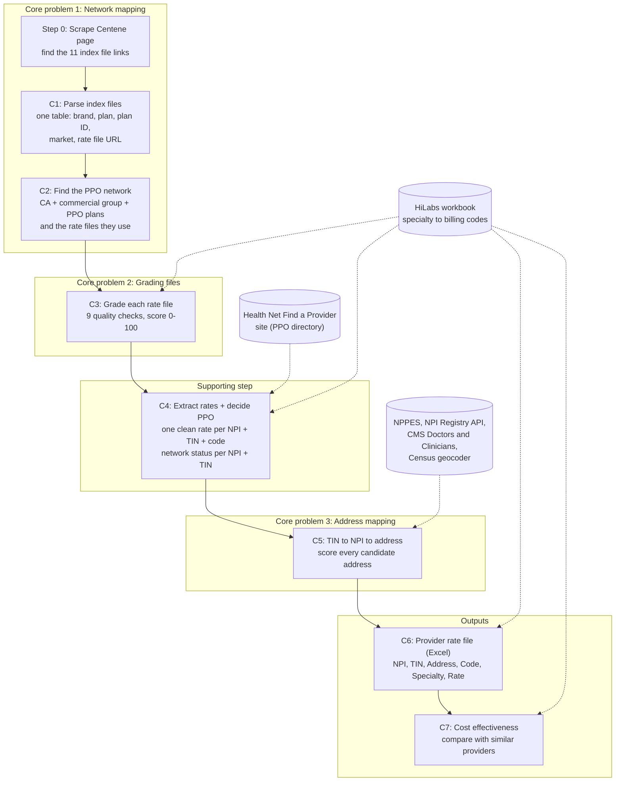

| Step | Package | One-line job |
|---|---|---|
| Step 0 + C1 | `ptd_pipeline/` | Find the 11 index files and flatten them into one plan table |
| C2 | `ptd_c2/` | Keep California commercial group plans, label each PPO / HMO / EPO / POS / EOA, list the PPO rate files |
| C3 | `ptd_c3/` | Grade each rate file with 9 quality checks |
| C4 | `ptd_c4/` | Pull one clean rate per NPI + TIN + code + variant, and decide each NPI + TIN's network status |
| Directory | `ptd_dir/`, `ptd_c4/dircheck.py` | Search every NPI on Health Net's Find a Provider site |
| C5 | `ptd_c5/` | Find and score each NPI + TIN's practice address |
| C6 | `ptd_c6/` | Write the provider rate file (deliverable 1) and the candidate file; optionally the PPO model |
| C7 | `ptd_c7/` | Score cost against similar providers |
| Runner | `ptd_run/` | Run everything, write the summary, logic file and metrics file |

---

## 4. Each step in detail

Each step below has a flowchart, what it measures and its result. Every number a judge might want to change lives in `pipeline/config/c2.yaml` to `c7.yaml` with a comment saying why; click "Fixed values" under a step to see them.

### Step 0 and C1: read the index files

**What it does.** Reads the Centene page, finds the index links under "Links to the download TOC files" (skipping the "Centene Employees" section), downloads each index and writes one row per plan x rate file.

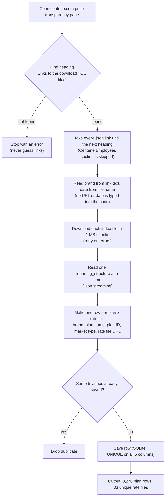

<details><summary>Fixed values used in this step</summary>

| Fixed value | Value | Why |
|---|---|---|
| Section heading looked for | "Links to the download TOC files" | Links are taken by page structure, so the employee "HEALTH NET" link is never picked up |
| Download chunk | 1 MiB, through a `.part` file | Flat memory, no half-written files |
| Dedup key | all 5 columns (`UNIQUE` in SQLite) | `plan_id` is reused and has placeholders like 999999999, so it can't be a key on its own |

</details>

**Metrics here:** index files found vs parsed, rows read vs unique rows. **Result:** 11 files, 3,275 pairs, 3,270 unique rows, 33 rate files (checked against an independent `json.load` of every index).

### C2: find the PPO plans and files

**What it does.** Keeps plans that are commercial group, Health Net and California, labels each one PPO / HMO / EPO / POS / HSP / EOA using several kinds of evidence in a fixed priority order, and lists the rate files the PPO plans use.

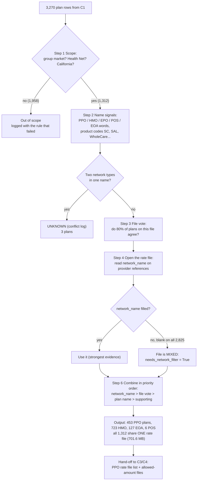

<details><summary>Fixed values used in this step</summary>

| Fixed value (`config/c2.yaml`) | Value | Why |
|---|---|---|
| `scope.keep_market_types` / `keep_brands` / `target_state` | group / healthnet / CA | The brief's scope |
| PPO keywords | `PPO`, `CUSPPO` | Real names include "CA L CUSPPO 15/250/20% RAP" |
| Non-PPO types | HMO, EPO, POS, HSP, EOA | EOA (Elect Open Access) is an HMO-based product; POS is not PPO |
| HMO product codes | SC, SmartCare, SAL, Salud, WholeCare, CommunityCare, Full Network; HSP: PureCare | Health Net product names |
| `EC` (EnhancedCare) | PPO only when no other type is in the name; `include_enhancedcare_ppo: true` | All 140 EC plans sit next to HMO or EOA in the real index |
| `file_vote.label_threshold` | 0.80 | A file is called PPO or non-PPO only when 80% of its other plans agree |
| `hypothesis_gate` | precision 0.90 on at least 10 plans | Weak name hints are tested before they are used |
| `supporting.payment` | ffs share 0.90, capitation share 0.20, at least 20 items | Payment pattern can only adjust confidence, never the label |
| `network_probe.max_bytes` | 200 MB | Enough to read the provider references at the top of a file |
| `validation.sample_size`, `seed` | 25, 42 | Hand-check sample against Summary of Benefits |

</details>

**Metrics here:** plans per label, conflicts, decided_by, confidence (high / medium / low). **Result:** 1,312 in scope, 453 PPO, 723 HMO, 127 EOA, 6 POS, 3 conflicts left UNKNOWN. **Key finding:** all 1,312 plans share one rate file with blank `network_name`, so C2 marks it `needs_network_filter = True` and C4 has to split PPO providers from HMO providers inside it.

### C3: grade the rate files

**What it does.** Streams each PPO rate file once and runs 9 checks. Each check gives a mark from 0 to 1; the marks are combined into a score out of 100 and a grade.

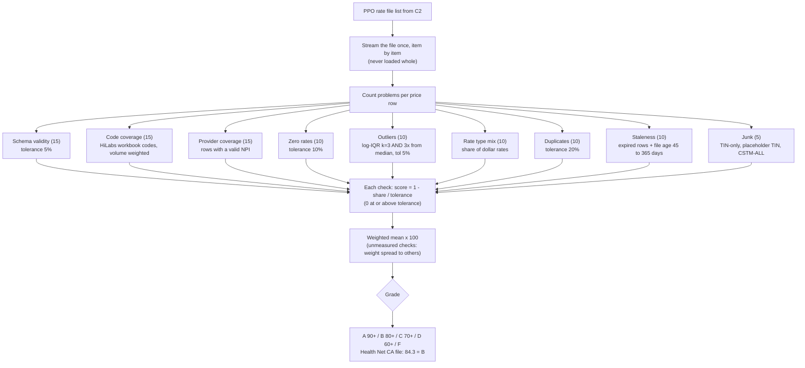

**How a check becomes a mark (the "tolerance").** For a "share of bad rows" check, `mark = 1 - share / tolerance`, and anything at or above the tolerance scores 0. Example: with a 10% tolerance for $0 rates, a file with 3% $0 rates scores 0.7.

| Metric (weight) | Tolerance | How it is calculated | Result |
|---|---|---|---|
| `schema_validity` (15) | 5% | Problems per record against CMS schema v2.0.0 (required fields, allowed values, code formats, blank `network_name`) | 0.15% problems, mark 0.97 (2,825 blank network names) |
| `code_coverage` (15) | none | Share of the workbook's 583 codes present, weighted by specialty weight x code share | 134 codes present, weighted 68.1%, mark 0.68 |
| `provider_coverage` (15) | none | Share of price rows tied to a valid NPI (10 digits + Luhn check digit) | 100%, mark 1.00 |
| `zero_rates` (10) | 10% | Rows with rate 0 or less | 0%, mark 1.00 |
| `outliers` (10) | 5% | Outside a log-IQR fence (k = 3) **and** at least 3x from the median of the same code + type + class + setting + modifier | 0.21%, mark 0.96 |
| `rate_type_mix` (10) | none | Share of dollar rates (negotiated, fee schedule, derived) | 100%, mark 1.00 |
| `duplicates` (10) | 20% | Rows repeating an earlier row exactly (code, providers, type, rate, class, setting, service codes, modifiers, expiry) | **97.35%, mark 0.00** (see note) |
| `staleness` (10) | 20% expired; file age 45 to 365 days | Expired rows (9999-12-31 is evergreen) and age of `last_updated_on` | 0% expired, 12 days old, mark 1.00 |
| `junk` (5) | 20% groups, 5% catch-all | TIN-only groups, placeholder TINs, bad NPIs, CSTM-ALL codes | 0%, mark 1.00 |

<details><summary>Fixed values used in this step</summary>

| Fixed value (`config/c3.yaml`) | Value |
|---|---|
| Weights | 15, 15, 15, 10, 10, 10, 10, 10, 5 (sum 100) |
| Grades | A 90+, B 80+, C 70+, D 60+, else F |
| Outlier fence | `iqr_k: 3.0`, `min_ratio_to_median: 3.0`, groups of 5+ rates |
| Placeholder TINs | 000000000, 999999999, 111111111, 123456789 |
| Duplicate check | file-wide up to 5,000,000 rows, then per item |

</details>

**Note on duplicates.** We re-counted this independently: 1,460,328 of the 1,500,288 price rows are revenue-code (RC) rows whose code, providers and price repeat in another item. Health Net publishes revenue code 636 (drugs) once per drug name, 129 times, each with the same 721-entry price table. Whether that counts as "duplicate" depends on whether the drug description is part of a row's identity. Our key leaves the description out, so the check scores 0 and costs the file 10 points. This is stated in the deliverable as a finding about the file.

### C4: extract clean rates

**What it does.** Reads the provider groups (TIN + NPIs) and the prices, keeps the workbook's codes, cleans the price rows and picks one rate per NPI + TIN + code + price variant. The provider references are read by one process while the price items are split over several worker processes.

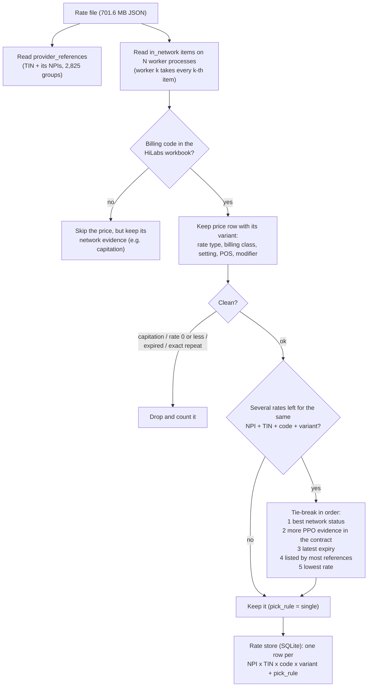

<details><summary>Fixed values used in this step</summary>

| Fixed value | Value | Why |
|---|---|---|
| `codes.scope` | `workbook` (583 codes); `--codes all` keeps every code | The deliverable and C7 weights are about HiLabs' codes |
| `extract.exclude_arrangements` | capitation | A per-member payment is not a per-service price |
| `drop_zero`, `drop_expired`, evergreen date | true, true, 9999-12-31 | $0 and expired rows are not prices |
| `tie_break` | network, ppo_evidence, expiry, support, lowest | Most trustworthy contract first, lowest rate only as a last resort |
| `stream.workers` | CPU cores minus 1 | Parallel parsing; result is the same with 1 or N workers (tested) |
| `stream.batch_rows` | 50,000 | SQLite insert batch |

</details>

**Metrics here:** price rows dropped by reason, how often each tie-break rule decided (`pick_rule`). **Result:** 2,720 in-scope price rows became 5,261 NPI x TIN x code x variant rates (2,121 NPIs, 1,692 TINs).

### C4: decide which providers are PPO

**Why this is needed.** The file has no network names, so C2's "PPO" only tells C4 which file to read, not which providers in it are PPO. The same doctor can hold a PPO contract and an HMO contract at different prices, under two provider references. So the decision is made **per NPI + TIN pair**, using evidence about that pair.

**Where the evidence comes from: Health Net's own Find a Provider site.**

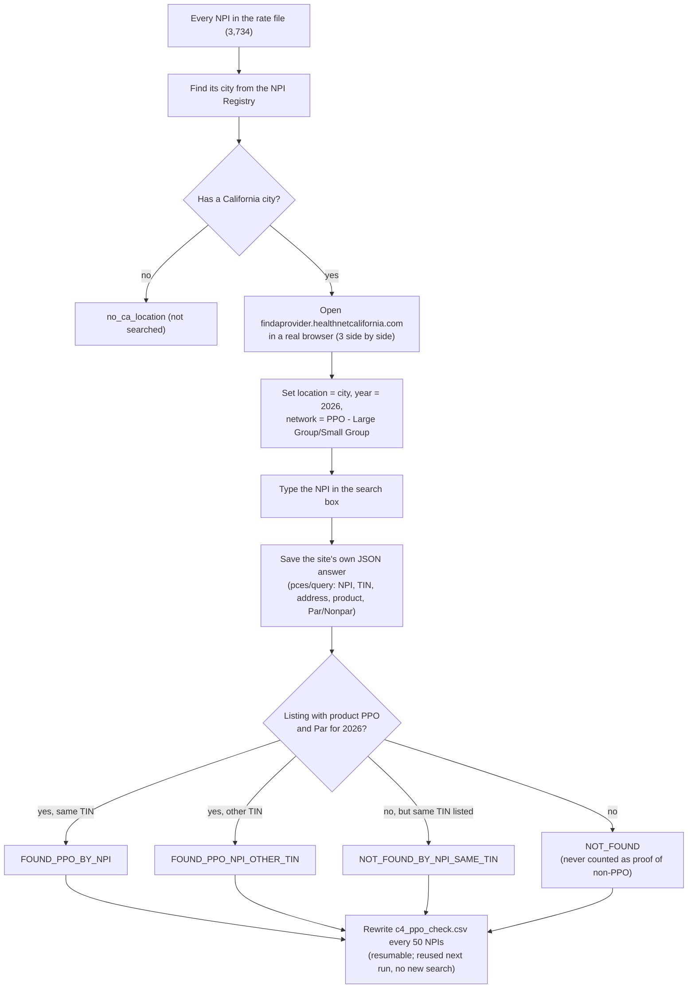

**How each NPI + TIN gets its status.**

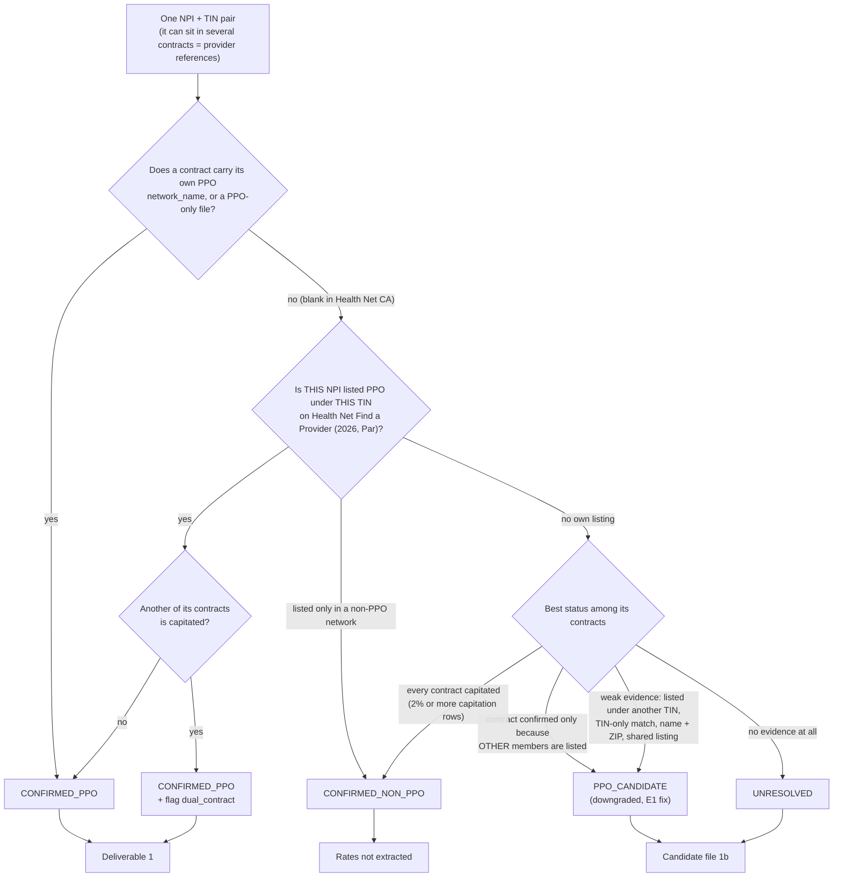

Rules in one breath: a pair is **confirmed PPO** only by its own contract's network name / a PPO-only file, or by **its own NPI being listed PPO under its own TIN**. Anything inferred from other people (other members of the same contract, the same TIN, a name + ZIP match, a listing under another TIN) can make it a **candidate**, never confirmed. Capitation (an HMO way of paying) makes a contract **non-PPO**, but a pair's own PPO listing wins over it and the pair is flagged `dual_contract`.

<details><summary>Fixed values used in this step</summary>

| Fixed value | Value | Why |
|---|---|---|
| Site network (CLI `--check-network`) | "PPO - Large Group/Small Group (Platinum, Gold, Silver, Bronze, GF Plans, HSA Compatible, HDHP)", product "HealthNet Commercial PPO", carrier "CA PPO Large and Small" | The employer group PPO network on the site |
| Year (CLI `--check-year`) | this year (2026) | Listing must be `Par` in that year |
| Browsers / save interval / delay (CLI) | 3 / every 50 NPIs / 1 s between searches | Speed vs politeness; resumable |
| Search radius | the site's 50 miles around the NPI's city | Site behaviour, not ours |
| `network.capitation_min_share` | 0.02 | 2% capitated rows marks an HMO-style contract |
| `network.seed_weights` | network_name 1.0, file_label 0.9, directory 0.9, capitation 0.8 | Evidence strength (scores, not probabilities) |
| `directory_weak_factor` | 0.4 | TIN-only or other-TIN matches count 40% and never confirm |
| `decide_min_share` | 0.65 | Share of evidence a side needs to win at contract level |
| `dual_contract` hypothesis | ratio 1.05, 3+ codes, 50% NPI overlap, used only at precision 0.90 on 10+ known pairs | "Higher-paid contract is PPO"; never passed its test on real data, so unused |
| `propagation` hypothesis | 30 iterations, alpha 0.8, 5-fold check, 90% accuracy, 5+ seeds per side, seed 7 | Label spreading over co-priced contracts; unused on real data (only 17-19 non-PPO seeds, no co-priced edges) |

</details>

**Metrics here:** status per pair and per contract, the reason (`status_basis`), site verdict per NPI. **Result:** 609 pairs confirmed PPO, 1,785 candidates, 1,371 unresolved, 10 non-PPO. 679 pairs are candidates only because other members of their contract were listed, and 14 are dual contracts.

### C5: link TIN to NPI to address

**What it does.** The rate file is the only public source that says which NPIs bill under which TIN (NPPES hides tax IDs). C5 collects every candidate address for each NPI, cleans them, and scores each one for that NPI + TIN.

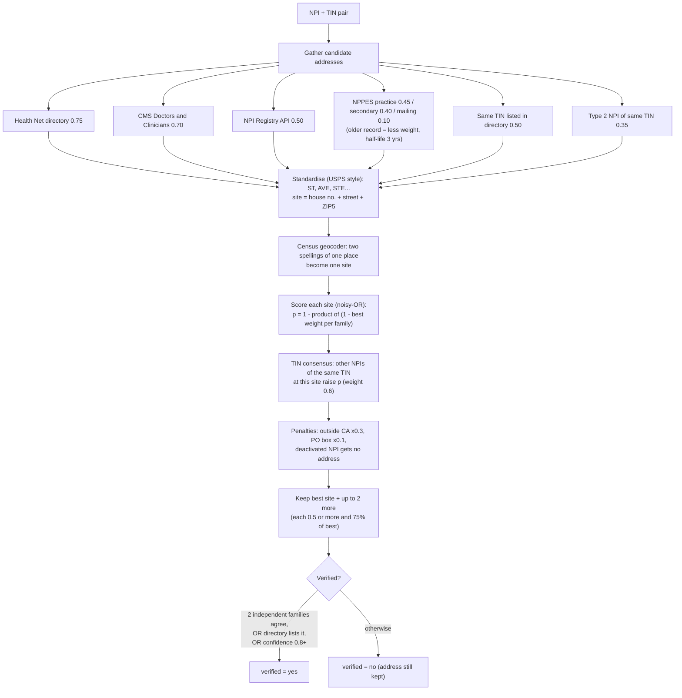

<details><summary>Fixed values used in this step</summary>

| Fixed value (`config/c5.yaml`) | Value | Why |
|---|---|---|
| Source weights | directory 0.75, CMS D&C 0.70, NPI API 0.50, same-TIN directory 0.50, NPPES practice 0.45, NPPES secondary 0.40, Type 2 site of same TIN 0.35, mailing 0.10 | How likely each source alone is a current practice site |
| Source families | NPPES variants are one family; only the best of a family counts | They share the same data, so they are not independent witnesses |
| NPPES recency | half-life 3 years, floor 0.4 | Old self-reported records are worth less |
| TIN consensus | weight 0.6, roster of 3+, new-site share 0.5, absent penalty 0.5 | A site most of a TIN shares is a real TIN site |
| Group alignment (CMS `org_pac_id`) | share 0.5, boost 0.5, discount 0.5 | Turns CMS groups into TIN-specific evidence |
| Penalties | outside CA x0.3, PO box x0.1, deactivated NPI = no address | |
| Selection | up to 3 sites; extra site needs 0.5 and 75% of best | Doctors often work at several sites of one group |
| Verified | 2 independent families, or directory listing, or confidence 0.8+ | |
| NPI API | 8 requests/s, 4 threads, 20 failures stop, cache 30 days | Polite use of a free API |
| Geocoder | batches of 1,000, CA only, cache 365 days | Merges two spellings of one place |
| Regions | ZIP3 to California market areas (e.g. 900-908 Los Angeles) | Used by C7 when no ZIP-county file is given |

</details>

**Metrics here:** % NPIs and TINs with an address and with a verified address, confidence bands, which sources agree, how often the chosen address differs from NPPES. **Result:** 99.75% of NPIs have an address and 36.19% a verified one. 813 pairs are at confidence 0.8 or more and 1,672 below 0.4 (NPPES only). 260 best addresses differ from NPPES's own, the geocoder merged 65 sites, and 162 pairs practise at more than one site.

### C6: build the provider rate file

**What it does.** Joins rates and addresses into one row per NPI + TIN + address + code, picks one headline price variant, adds the specialty and splits rows by network status.

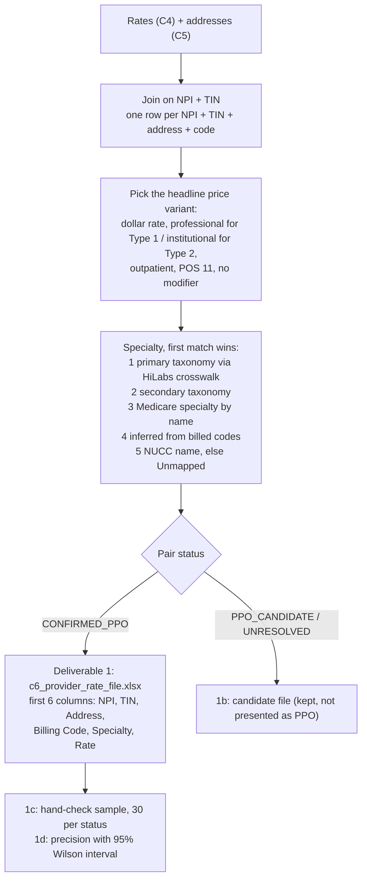

<details><summary>Fixed values used in this step</summary>

| Fixed value (`config/c6.yaml`) | Value |
|---|---|
| Headline variant order | negotiated > fee schedule > derived > per diem > percentage; professional first for Type 1, institutional first for Type 2; outpatient > both > inpatient; POS 11; no modifier |
| Specialty inference | at least 3 workbook codes, F-score 0.25 |
| Deliverable 1 / candidate statuses | CONFIRMED_PPO / PPO_CANDIDATE + UNRESOLVED |
| Hand-check sample | 30 pairs per status |
| Excel limits | 1,000,000 rows per sheet, 3,000,000 rows max (the CSV always has every row) |

</details>

**Metrics here:** rows per file, specialty source per NPI, precision of each status from the hand-check sample (Wilson 95% interval; not filled in yet). **Result:** deliverable 1 has 1,277 rows (209 pairs, 132 TINs, 101 codes), all with an address; the candidate file has 4,072 rows. Specialty source: primary taxonomy 1,510 NPIs, secondary 76, unmapped taxonomy 518, inferred from codes 4.

### C7: cost effectiveness

**What it does.** Compares each rate with what similar providers get for the same code and variant, then combines a provider's codes into one cost index, score and tier. Confirmed PPO and candidate providers are scored separately, so unproven rates never move the PPO benchmark.

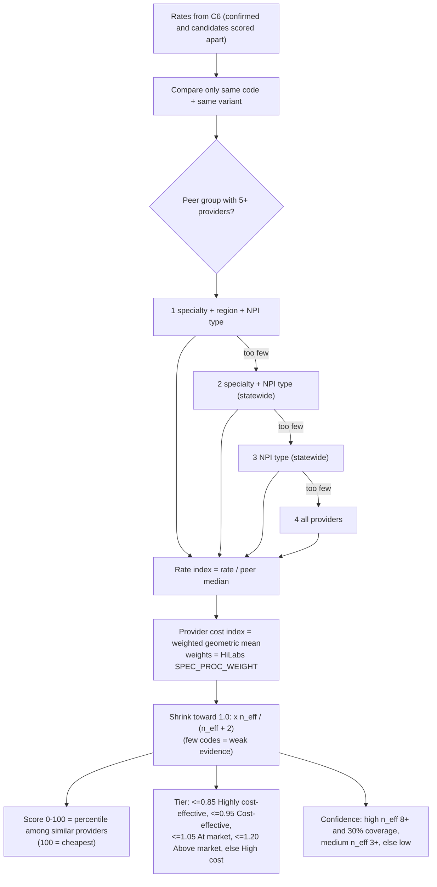

<details><summary>Formulas used in this step</summary>

| Metric | Formula | Why |
|---|---|---|
| Rate index | rate / peer median | 1.00 = paid like similar providers |
| Cost index | weighted geometric mean of rate indexes, weights = HiLabs `SPEC_PROC_WEIGHT` | Ratios average on a log scale; common codes count more |
| n_eff | (sum w)^2 / sum w^2 | Effective number of codes behind the index |
| Shrunk index | exp(ln(index) x n_eff / (n_eff + 2)) | One cheap code is weak evidence |
| Cost score 0-100 | 100 x (1 - percentile among similar providers) | 100 = cheapest |
| TIN index | n_eff-weighted mean of members' log indexes | Group-level view for contracting |

</details>

<details><summary>Fixed values used in this step</summary>

| Fixed value (`config/c7.yaml`) | Value |
|---|---|
| Minimum peers | 5 |
| Peer levels | specialty + region + type, specialty + type, type, all |
| Shrinkage k | 2.0 |
| Cohort for the score | specialty + region, then specialty, then all; 10+ providers |
| Tiers | 0.85 / 0.95 / 1.05 / 1.20 |
| Confidence | high: n_eff 8+ and 30% coverage; medium: n_eff 3+ |
| Left out | percentage-of-charges rates |

</details>

**Result:** 494 confirmed rates benchmarked; 157 providers and 92 TINs scored. Tiers: 12 highly cost-effective, 7 cost-effective, 119 at market, 13 above market, 6 high cost (most are "At market" because each provider has only a few priced codes). 1,796 candidate providers are scored separately.


---

## 5. Optional: the PPO probability model

**This is not part of the default pipeline.** It is switched on only with `--ppo-model`; without it every run is exactly as described in sections 3 and 4, and deliverable 1 never changes. The code is `pipeline/ptd_c6/ppo_model.py`; the datasets, weights and results it produced are in [`ml_ppo_model/`](ml_ppo_model/).

### 5.1 Why a model

Today every NPI + TIN pair gets one of four statuses, and only pairs Health Net's site lists under their own NPI and TIN are confirmed. The other 2,280 searched pairs are all treated alike. The model gives each of them a **probability of being PPO**, so they are ranked instead of set aside.

- **The file can't tell us.** The network name is blank, so the only direct proof is a listing on the finder.
- **The evidence is positive-only.** A listing proves PPO, but "not listed" doesn't prove the opposite: group NPIs and many behavioural clinicians are PPO but rarely listed under their own NPI. Positive-unlabelled (PU) learning handles exactly this.
- **Many weak clues, none decisive.** Listed neighbours in the same contract or TIN, NPI type, specialty and region all hint at PPO. A model learns how much each one counts.
- **A probability suits C7.** Each candidate rate counts in the peer benchmark in proportion to how likely it is PPO.
- **It stays explainable.** One weight per clue. The rate itself is left out on purpose, so C7's cost scores can't echo the model.

### 5.2 How it works

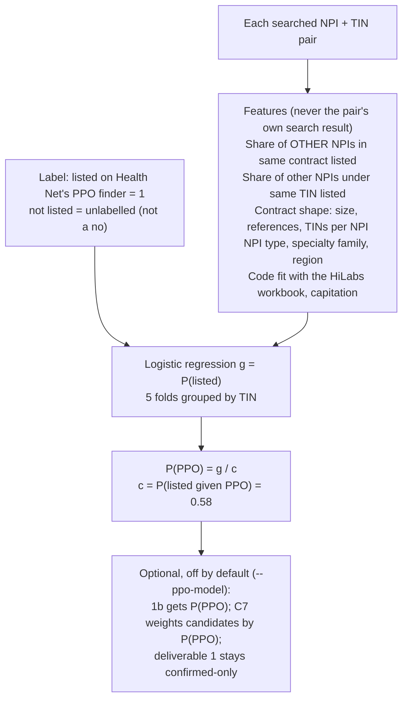

1. Every searched NPI + TIN pair gets the features below. A pair's own search result is never one of its features.
2. A logistic regression learns g = P(listed on the finder), validated with 5 folds grouped by TIN so one group never sits on both sides.
3. Because unlisted is "unknown", not "no", the probability is corrected: **P(PPO) = g / c**, where c = P(listed given PPO) = **0.5826**, measured on held-out listed pairs.
4. With `--ppo-model`, the candidate file gets a `ppo_probability` column with the top reasons and their values, and C7 weights candidate rates by P(PPO).

### 5.3 Training data

The model is trained on the pipeline's own Health Net site check, `c4_ppo_check.csv`, refitted on every run. For the run in section 1:

| | Count |
|---|---|
| Searched NPI + TIN pairs used for training | 2,780 |
| Listed on the PPO finder (label = 1) | 945 |
| ...listed under the same TIN | 594 |
| Not listed (unlabelled, not "no") | 1,835 |

| Feature | What it means |
|---|---|
| `ref_found_share` | Share of the **other** NPIs in the same contract that are listed |
| `ref_searched` | How many other NPIs in the same contract were searched |
| `tin_found_share`, `tin_searched` | The same, for other NPIs under the same TIN |
| `ref_size`, `n_refs`, `tins_per_npi` | Contract size, number of contracts the NPI is in, TINs per NPI |
| `npi_type_2` | 1 for an organisation NPI (from NPPES) |
| `capitated` | The contract has capitated (HMO-style) rows |
| `code_fit` | How well the NPI's codes match its specialty in the HiLabs workbook |
| `family=…` | Specialty family, one-hot: primary care, medical, surgical, behavioural, therapy, facility, hospital-based |
| `region=…` | California market area from ZIP, one-hot |

C5's "address verified" flag was dropped: it is mostly set by the site listing itself, and with it the AUC was a misleading 0.98.

### 5.4 Weights

Standardised coefficients (each feature scaled to mean 0, standard deviation 1), so their sizes can be compared. Positive means more likely listed. Full list: [`ml_ppo_model/weights/ppo_model_coefficients.csv`](ml_ppo_model/weights/ppo_model_coefficients.csv); full model report: [`ml_ppo_model/weights/model_report.md`](ml_ppo_model/weights/model_report.md).

| Feature | Weight | Reading |
|---|---|---|
| `npi_type_2` | −1.34 | Organisations are rarely listed under their own NPI |
| `family=behavioural` | −1.31 | Behavioural clinicians are rarely listed |
| `ref_searched` | −0.66 | Many searched neighbours with few listed is a bad sign |
| `ref_found_share` | +0.56 | Listed contract neighbours |
| `family=medical` | −0.47 | |
| `family=surgical` | −0.44 | |
| `n_refs` | +0.41 | In several contracts |
| `tin_found_share` | +0.36 | Listed TIN neighbours |
| `family=facility` | +0.34 | |
| `tin_searched` | −0.27 | |
| `code_fit` | −0.24 | |
| `tins_per_npi` | −0.22 | |
| `family=primary_care` | −0.17 | |
| `ref_size` | −0.15 | |
| `capitated` | −0.10 | |
| `family=hospital_based` | −0.10 | |
| `family=therapy` | +0.01 | |
| `region=…` (17 areas) | +0.01 to +0.24 | Small; Los Angeles and San Gabriel Valley highest |

### 5.5 Results

**With and without the model** (same run, same 2,853 searched NPIs)

| | Without the model | With the model |
|---|---|---|
| Deliverable 1 rows | 1,277 | 1,277, unchanged by design |
| Confirmed providers scored in C7 | 157 | 157, no tier changed |
| Unconfirmed pairs with a P(PPO) | none | 2,280 |
| ...with P(PPO) of 0.5 or more | none | **792** (529 candidates, 263 unresolved) |
| ...with P(PPO) of 0.8 or more | none | 407 (314 candidates, 93 unresolved) |
| Candidate cost tiers (HCE / CE / at market / above / high) | 68 / 183 / 1,300 / 173 / 72 | 75 / 220 / 1,224 / 207 / 70 |
| Candidate providers whose tier changed | | 178 of 1,796 (10%) |

**How well it ranks, out of time.** Trained only on the first 1,703 NPIs searched, then scored the 1,112 pairs searched later ([`results/holdout_out_of_time.json`](ml_ppo_model/results/holdout_out_of_time.json)).

| Measure on the later pairs | Value |
|---|---|
| AUC of the model | **0.876** |
| AUC of the rule-based status | 0.49 (chance) |
| AUC of "other contract members are listed" alone | 0.69 |
| Listed share in the model's top 20% | **78%**, against 34.9% overall |
| Cross-validated AUC (5 folds by TIN, 2,780 pairs) | 0.866 |

**Is g honest?** Held-out reliability: when the model says g is about 0.05, 5% are listed; about 0.48, 57%; about 0.75, 75%.

### 5.6 Checking the factors against real PPO and HMO labels

The finder only shows some contracted providers, so "listed" is a weak label. To test the model's assumptions we built two datasets with **real network labels** from Health Net's directory service, which returns every Health Net network a provider is contracted in (PPO, the commercial HMOs, EPO and so on). Labels are as of 2026-10-18.

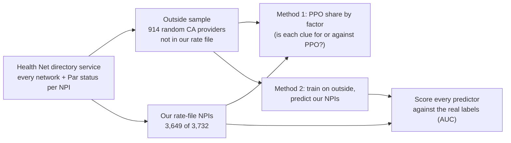

| Dataset | File | Rows | What it holds |
|---|---|---|---|
| Outside sample | [`ml_ppo_model/datasets/outside_sample_dataset.csv`](ml_ppo_model/datasets/outside_sample_dataset.csv) | 914 | Random California providers in a Health Net commercial network, drawn from 1,500 map points over 35 population centres. `w` undoes the sampling's tilt. Labels `ppo`, `hmo`; features from the directory record |
| Our NPIs | [`ml_ppo_model/datasets/rate_file_npis_labelled.csv`](ml_ppo_model/datasets/rate_file_npis_labelled.csv) | 3,649 | Rate-file NPIs found in the directory (83 are in no Health Net network, 2 failed). Real labels, the browser verdict, the pipeline's features and both models' scores |

<details><summary>Columns of the two datasets</summary>

- **outside_sample_dataset.csv**: `npi`, `w` (sampling weight), `ppo`, `hmo`, `epo_hsp_eoa`, `listed_commercial`, `n_commercial_networks`, `npi_type_2`, `ptype`, `family`, `specialty`, `taxonomy`, `region`, `n_tins`, `capitated_ppg`, `in_ppg`.
- **rate_file_npis_labelled.csv**: `npi`, `ppo_backend` (real PPO label), `hmo_backend`, `listed_any`, `browser_verdict` (what the finder search said), `npi_type`, `family`, `region`, `n_tins`, `capitated_contract`, `sample_model_p` (method 2's score), `inhouse_model_p` (this model's score).

</details>

**PPO is close to universal.** 94% of outside providers and 86% of our rate-file NPIs (3,220 of 3,732) are contracted PPO. Of the 1,951 NPIs the finder search called "not found", **1,607 are PPO**, mostly group-practice records the public finder doesn't show.

**Method 1: is each clue for or against PPO?**

| Factor | Model assumed | Real labels say | Verdict |
|---|---|---|---|
| Other NPIs in the same contract are PPO | For | 32% PPO when under a quarter are, 88% when three quarters or more are | **Strongly supported** |
| Other NPIs under the same TIN are PPO | For | 34% vs 89% | **Strongly supported** |
| Capitated medical group | Against | 81% vs 94% outside; 83% vs 86% ours | Supported, modest |
| Organisation NPI | Strongly against | No difference outside; 84% vs 97% ours. Mostly the website: 31% of PPO organisations are shown on the finder, against 65% of PPO individuals | Partly |
| Behavioural specialty | Against | 98% outside, 95% ours, both above average | **Not supported, reversed** |
| Facility | For | Average outside, 81% ours | Not supported |
| Contract size | Slightly for | 92% for 1 to 5 NPIs, 83% for 6 to 50, 67% for 51+ | **Not supported, reversed** |
| Region | Small | Mostly 90 to 100%; East Bay 73% | Small, as assumed |

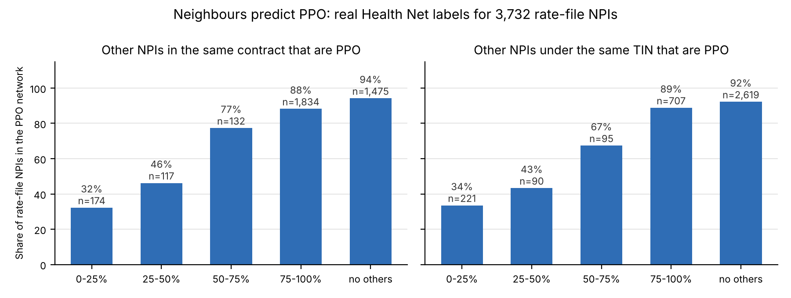

**Method 2 and the AUC comparison** (against the real "contracted PPO" label; [`results/factor_check_results.json`](ml_ppo_model/results/factor_check_results.json))

| Predictor | AUC |
|---|---|
| Model trained on the outside sample (method 2) | 0.46 |
| This model (trained on "listed on the finder") | 0.62 |
| Rule-based pair status | 0.63 |
| Share of contract neighbours that are PPO, alone | 0.72 |
| Share of TIN neighbours that are PPO, alone | 0.73 |
| Rate-file clues trained on the real labels (5 folds by TIN) | **0.79** |

Method 2 fails because almost everyone outside is PPO, and the clues that matter most (contract and TIN neighbours) only exist inside a rate file.

**What this means.** The model is good at what it was trained for, predicting "shown on the finder" (0.876), but that is a different question from "contracted PPO". The better route is to use the directory's network status directly as C4 evidence (about 20 minutes for every NPI, against about 12 hours for the browser search) and keep a model only for the 83 NPIs in no Health Net network, retrained on the real labels. Two things need a team decision first: "contracted but not shown on the finder" is read as PPO (likely, but inferred), and the directory service is the site's own backend, queried at about 3 requests a second.

### 5.7 Limits

- The label is "listed on the finder", not "is PPO". The g / c correction assumes PPO providers with the same clues are equally likely to be listed, and section 5.6 shows that isn't true for organisations.
- There is no gold-standard non-PPO set in the pipeline; fill in `1c_network_check_sample.csv` to measure precision at a chosen threshold.
- It learns from one payer's site and should be refitted whenever the site-check CSV grows (it is, on every run).

### 5.8 Reproducing the datasets

The scripts in [`ml_ppo_model/scripts/`](ml_ppo_model/scripts/) rebuild the two datasets; the committed CSVs are the ones used above and were not rebuilt.

```bash
cd ml_ppo_model/scripts
python probe.py                                  # opens the finder once, saves its search request to reqs.json (git-ignored)
python collect.py npis <npi_list.txt> work/ours.jsonl     # network profile per NPI
python collect.py sample work/sample.jsonl 1500           # outside sample from 1,500 map points
python build.py                                  # profiles to rows
python analyze.py                                # both CSVs and results.json (kept here as results/factor_check_results.json)
```

Paths can be set with `PPO_EXT`, `PPO_DB`, `PPO_CHECK` and `PPO_MODEL_CSV`, and Chrome with `CHROME_PATH`.

---

## 6. Inputs and outputs

**Inputs**

| Input | Where it comes from | Used in | Needed? |
|---|---|---|---|
| Centene price transparency page and its 11 index files | https://www.centene.com/price-transparency-files.html (found by the scraper) | Step 0, C1 | Yes |
| Health Net CA in-network rate file (701.6 MB) and allowed-amount file | URLs inside the Health Net index | C2 to C4 | Yes |
| HiLabs workbook *Rate Benchmarking Individual Weights_Hackathon.xlsx* (taxonomy crosswalk, specialty weights, 946 specialty x code weights over 583 codes) | Given by HiLabs; put it in `pipeline/` (not in git) | C3, C4, C6, C7 | Strongly recommended |
| `c4_ppo_check.csv`: Health Net Find a Provider result per NPI + TIN | Made by C4 `--check-directory`, or a saved copy | C4, C5, PPO model | Needed to confirm any PPO provider |
| NPPES monthly file (1.16 GB zip) | CMS, downloaded by `--fetch-public` | C5, C6 | Recommended |
| CMS Doctors and Clinicians file (900 MB) | CMS, downloaded by `--fetch-public` | C5 | Recommended |
| NPI Registry API | npiregistry.cms.hhs.gov, cached 30 days | C5, site search | Automatic |
| US Census Bureau geocoder | geocoding.geo.census.gov, cached 1 year | C5 | Automatic |
| NUCC taxonomy CSV (`--nucc`) | nucc.org | C6 (names for unmapped taxonomies) | Optional |
| ZIP to county file (`--zip-county`) | e.g. HUD ZIP-COUNTY | C5, C7 regions | Optional (else ZIP3 areas) |

**Outputs** (inside `pipeline/`)

| Folder | What is in it |
|---|---|
| `data/` | Index files, the C1 table (`index_table.csv`, `rate_files.csv`, `ptd.sqlite`), rate files, public files, API and geocoder caches |
| `out/c2/` | Plan labels, PPO rate-file list, exclusions, conflicts, validation sample |
| `out/c3/` | Score per file, every metric with its reason, example bad rows |
| `out/c4/` | Network status per reference and per NPI + TIN, `c4_ppo_check.csv`, extraction log |
| `out/rates.sqlite` | The shared rate store C4 to C7 read and write |
| `out/c5/` | Addresses with confidence, every candidate address, the address logic |
| `out/c6/` | Deliverable 1, candidate file, hand-check sample, accuracy report; with `--ppo-model`, `c6_ppo_probability.csv` and `c6_ppo_model.md` |
| `out/c7/`, `out/c7_candidates/` | Cost scores per rate, provider and TIN; metrics file |
| `out/deliverables/` | Deliverables 1 to 4 and 7b with the names in section 1 |

---

## 7. How long it takes, and the bottlenecks

Measured on a full run in a cloud container with 4 CPU cores, from each stage's start and finish times. **Total: 5 minutes 34 seconds**, reusing the saved site check.

| Step | Time | What dominates |
|---|---|---|
| Download NPPES (1.16 GB) + CMS D&C (0.9 GB) | 58 s | Network; skip on reruns with `--nppes` / `--dac` |
| Step 0 + C1 | 2 s | 11 small index files |
| C2 | 4.6 s | Reading the top of the rate file for network names |
| C3 | 29.5 s | Streaming 701.6 MB / 1.5M price rows once |
| C4 | 14.6 s | Reading the file with 3 workers (12.4 s) |
| C5 | 221.5 s | Scanning all 9.85M NPPES rows (136 s) and the Census geocoder (about 70 s) |
| C6 | 1.2 s | Writing the Excel |
| C7 | 2.5 s | Both sets |

**Time to give every NPI a PPO status and an address**

| Part | Per NPI | All 3,734 NPIs | Basis |
|---|---|---|---|
| Health Net site search (3 browsers) | about 12 s | **about 12.4 hours** | Measured at about 5 NPIs a minute; the full-file time is a projection |
| Health Net directory service (section 5.6) | about 0.3 s | about 20 minutes | Measured on all NPIs |
| C4 status from the saved CSV | under 0.001 s | under 1 s | Measured |
| C5 address with confidence | about 0.085 s | about 5 minutes | Measured; mostly a fixed NPPES scan |

**Bottlenecks, biggest first**

1. **The site search is 99% of the end-to-end time.** It drives a real browser per NPI because the site has no bulk download. Calling the directory service directly cuts it to about 20 minutes (a team decision, section 5.6).
2. **NPPES scan (136 s).** `python -m ptd_c5 extract-nppes --state CA` makes a California-only file once; a scan of that takes about 9 s.
3. **Geocoder (about 70 s).** Cached for a year, so a rerun is nearly free.
4. **C3 and C4 each stream the rate file (29.5 s + 14.6 s).** A combined pass would save about 15 s; not worth the coupling at this size.

For scale: on a 385 MB synthetic file with 40,000 references and 15.9M output rates, C4 took 73 s and 434 MB of memory. It streams item by item, shards work across processes and stores repeated provider lists once, so memory stays flat as files grow.

---

## 8. Known limits

- **Deliverable 1 depends on the site search.** Only NPIs the finder lists under their own NPI and TIN are confirmed. Organisations are listed far less often than individuals, so many real PPO groups stay candidates (section 5.6 measures how many).
- **Precision of "confirmed" is not measured yet.** Fill in `1c_network_check_sample.csv` and run `ptd_c6 check-network`.
- **The rate file covers only 134 of the 583 workbook codes**, so cost scores rest on 2 or 3 codes per provider.
- **About two thirds of addresses rest on NPPES alone** (confidence below 0.4).
- **The duplicate check scores 0** because of the repeated revenue-code tables (C3 note).
- **Weights and tolerances are judgement, not fitted.** The workbook weights come from HiLabs; everything else is a documented default in `config/`.
- **Live sources drift.** Reuse the saved CSV and pass `--as-of` for repeatable runs.

---

## 9. Repository layout

```
ml_ppo_model/                  optional PPO probability model: data, weights, results, scripts
├── datasets/                  outside_sample_dataset.csv, rate_file_npis_labelled.csv (real network labels)
├── weights/                   ppo_model_coefficients.csv, model_report.md
├── results/                   holdout_out_of_time.json, factor_check_results.json, r_neighbours.png
└── scripts/                   probe.py, collect.py, q.py, build.py, analyze.py
pipeline/
├── config/c2.yaml … c7.yaml   every threshold, weight and rule, with the reason
├── ptd_pipeline/              Step 0 + C1 (scraper, index parser)
├── ptd_c2/                    C2: scope, name signals, file vote, network probe, validation
├── ptd_c3/                    C3: streaming scan, metrics, workbook code weights
├── ptd_c4/                    C4: parallel ingest, network status, extraction, site search, PPO check CSV
├── ptd_dir/                   Health Net site driver
├── ptd_c5/                    C5: address standardiser, sources, scoring, geocoder
├── ptd_c6/                    C6: rate file, specialty, network check, ppo_model.py (optional)
├── ptd_c7/                    C7: peer groups, scores, report
├── ptd_run/                   one-command runner, summary, logic and metrics files
├── tools/                     synthetic rate file generator, network probe
├── tests/                     118 offline tests, including a synthetic California world with known answers
└── README.md                  detailed technical reference for every stage
```

Context: Health Net is ending California commercial group plans, with most policies ending 2027-02-28.
